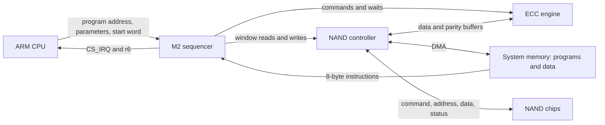

# Chapter 2 — Architecture: execution model, start, stop and fault handling

Summary: how the sequencer runs a program, how the CPU starts, pauses, holds,
stops and resets it, what happens at END and at a fault, and how instruction
completion relates to peripheral data. The three blocks are described in
[chapter 1, section 1.4](01-overview.md#14-the-three-blocks).

M2 is a small programmable sequencer attached to the NAND controller of the
S5L8720. It executes its own instruction format, not ARM instructions. The ARM
CPU supplies the program and the parameters; the sequencer drives the NAND
controller, the DMA and the ECC engine and reports completion through
registers (observed in the original CPU driver and programs,
[chapter 14, section 14.3](14-evidence.md#original-code-observations)).

## 2.1 How the sequencer is started and stopped

**Starting** (original CPU driver, `bl_NandReadOnly` `mem:0x51b8`; details in
[chapter 3, section 3.5](03-cpu-memory-map.md#35-starting-and-finishing-a-run)):

1. The engine is reset (section "Stopping" below), then the parameters are
   written to parameter RAM and the program is in system memory. A reset after
   the parameters are written clears them (M2-54, M2-55).
2. `FMSS_PROG` (`0xc04`) = the program's bus address; `CS_IRQ` = `0xff`.
3. Buffer handshake: `c6c` = 0, `c60` = 1, wait for `c64` ≠ 0, `c60` = 0; or
   `c6c` = `0x10` on the alternate path without the handshake (observed, M2-20).
4. `FMSS_CTRL` (`0xc00`) = `0xffb5` (bootloader) or `0xfff5` (restore OS).
   Bit 0 starts the program at its first instruction; r0..r7 keep the values the
   CPU wrote (device, M2-02, M2-157). The first start word after the ordinary reset runs
   the program even when its instruction 0 is not END (M2-151), and so does the
   first start after power-on (M2-431).

**Stopping:**

- **END:** the program executes `end`. `CS_IRQ` bit 0 is set and r6 is visible
  as `SEQ_RESULT` at `0xc30` (device, M2-02).
- **Fault:** an unmet `wait` or an illegal opcode sets `CS_IRQ` bit 2 after the
  timeout; the sequencer then vectors to `C4C` or continues, as `C58` bit 2
  selects (M2-11, section 2.3). The program must still reach `end`.
- **STOP (`C00` = 8):** from a running program, STOP sets PC = 0 and `C08` = 0
  and preserves all eight GPRs, all 32 parameter words, `C10`, the program
  base, the instruction latches and the fault vector (device, M2-53, M2-54).
- **Abort (`C00` = 2):** the original reset writes it when `C08` = 4 and waits
  for `C08` = 0 or 3 (observed, `mem:0x502c`).
- **Clearing step (`C00` = `0x80000`):** alone, after STOP or abort, or
  followed by either, it clears the GPRs, the parameter RAM and `C04`, `C10`,
  `C40`, `C44`, `C4C` and leaves `C00` = `0x7f60` (0 when STOP follows); STOP,
  abort and STOP then abort clear none of them, and no `C00` sequence changes
  FMC `0x00c..0x05c` or `ECC_CTRL` (device, M2-54, M2-422). The
  complete reset sequence leaves FMC `00c..05c`, `ECC_CTRL` and the parameter
  RAM zero and `FMC_DMA_CTRL` = 7 (M2-123): `FMCTRL1` bit 31 zeroes the FMC
  words and sets `FMC_DMA_CTRL` to 7, `0x81c` = 1 zeroes `ECC_CTRL`, and
  `FMCTRL1` `0x800` changes none of them (M2-645). The per-case reset also sets
  the phase of the timeout prescaler (M2-631). Separate buffer, FMC and ECC reset
  steps preserve GPR and parameter values (M2-54).
- **Pause (`pause`, opcode `12`):** the two measured forms stop at the
  instruction with `C08` = `a`, `CS_IRQ` = 8 and PC at the `pause`
  (M2-14). The original CPU handler advances PC by 8, acknowledges bit 3 and
  sets `C00` bit 0 (observed, `mem:0x4d08`); with these CPU writes the program
  continues to the following instruction and END (device, M2-25). Setting
  `FMSS_PROG` to an END program, PC = 0, acknowledging and resuming ends a
  paused run so that ordinary reset completes; a pause inherited from an earlier
  run needs the abort in addition (device, M2-26).
- **Held by the buffer request:** a CPU write `C60` = 1 while a program runs
  holds the engine: `C08` = 1, `C00` = `0x407b4`, `C60` = `C64` = 1; STOP and
  the buffer handshake no longer reset it (M2-121). Writing `C60` = 0 releases
  the hold (M2-126).
- **Blocked `evjmp`:** a zero-field `evjmp` started with `C00` = 1 stays at
  `C08` = `b`, PC = the `evjmp` offset (`0x20` and `0x38` measured), `CS_IRQ` = 0;
  STOP leaves it there (M2-57, M2-62, M2-392). Abort
  gives `C08` = 3, and the clearing step issued before another STOP gives 0;
  ordinary reset then completes and the next program runs (device, M2-62,
  M2-63).
- **Active status latch:** a NAND status-latch transaction survives END and
  blocks the FMC acknowledgement step of the reset (`FMCTRL1` = 2).
  `FMCTRL1` = `0x30020` with acknowledgement `0x1800000` releases it (device,
  M2-31, M2-181).

**State codes** read by the CPU in `C08`:

| `C08` | state |
|---|---|
| 0 | idle (after END, STOP or reset) |
| 1, 2, 9 | a program running: a delay loop, a loop after `sig`, a program running on after a timeout fault with `C58` = 0 and a fault handler after a vectored fault; the value differs between identical runs (M2-384); 1 also while held by `C60` = 1 (M2-121) |
| 3 | after abort from state `b` or from a running program (M2-62, M2-422); a running program frozen by start-word bit 1 (M2-158) |
| 4 | waiting: unmet `wait` or `wait2`, illegal opcode, `tmwait` in progress, a wait held by start word 1 (M2-13, M2-56, M2-384) |
| `a` | stopped at `pause`, `CS_IRQ` bit 3 (M2-14) |
| `b` | blocked zero-field `evjmp` started with `C00` = 1 (M2-57) |

A program reading `C08` itself reads 5 (M2-70). Raw `C00` readbacks are
the start word with bit 18 set and bit 0 clear while running or waiting (`0x4ffb4` for `0xffb5`, M2-384), `0x40000` stopped, `0x40002` after STOP and abort and
`0x7f60` after the clearing step; `C14` stays `0x7f` in these steps
([chapter 8](08-sequencer-control-registers.md); M2-54, M2-281). After every
END, a handler END included, `C08` reads 0 (M2-384).

**Power-on state.** At the first access after a power cycle the window equals
the window after the ordinary reset in every word except `C00` (`0x7f60` at
power-on, the last start word after a reset) and `C04` (0 at power-on, the
program address after a reset); `C08` is 0 and `C14` reads `0x7f` (M2-430). The
first program after power-on runs on its first start, also when its
instruction 0 is not END (M2-431).

**Transitions:**

| from | event | to |
|---|---|---|
| idle (0) | start word bit 0 | running |
| running | `end`; STOP (`C00` = 8) | idle (0) |
| running | unmet `wait` | waiting (4) |
| waiting (4) | event; timeout fault | running |
| waiting (4) | timeout fault | running: the fault handler with `C58` = 4, the next instruction with `C58` = 0 (`C08` 1, 2 or 9; M2-384) |
| waiting (4) | abort (`C00` = 2) | idle (0) |
| running | `pause` | paused (`a`) |
| paused (`a`) | PC + 8, acknowledge bit 3, `C00` bit 0 | running |
| running | zero-field `evjmp` with `C00` = 1 | blocked (`b`) |
| blocked (`b`) | abort (`C00` = 2) | 3 |
| 3 | `C00` = 0x80000 | idle (0) |
| running | start word with bit 1 | frozen (3); a later start resumes it (M2-158) |
| running | start word with bit 3 or 16 | restarts at instruction 0 after the release (M2-158) |
| running | CPU writes `C60` = 1 | held (1) |
| held (1) | `C60` = 0 | released (M2-126) |

## 2.2 Execution model

- The sequencer fetches 8-byte little-endian instructions (`arg:u16`, `R:u8`,
  `opcode:u8`, `imm:u32`) from system memory, starting at the bus address in
  `FMSS_PROG` (M2-01; [chapter 5](05-instruction-encoding.md)).
- It has eight 32-bit registers r0..r7, readable and writable by the CPU at
  `0xc18 + 4*n`; r6 (`0xc30`) is the result word (M2-02). There are no flags
  or condition codes: `bz`/`bnz` test a register, and `jr` jumps to r[arg]
  iff r[R] ≠ 0 (M2-110).
- The PC (`FMSS_PC`, `0xc38`) is a byte offset from the program start. Branch
  and `jr` targets are byte offsets with the low 3 bits ignored and no wrap
  between 2^15 and 2^24; the PC has at least 25 bits (M2-105, M2-122, M2-725). A
  write of r8 is a local jump (M2-43).
- A register written by one instruction is seen by the next instruction at
  distance 0 for `add`, `mov`, the `ldi` address, the `sti` data and `bnz`
  (M2-108): there is no register-write hazard.
- Register-access instructions (`wr`, `st`, `ld`) address window offsets:
  `0x000..` NAND controller, `0x800..` ECC engine, `0xc00..` sequencer
  control, `0xd00..` parameter RAM. `ld` masks the word by AND. `pld`/`pst`
  (`18`/`19`) reach the same window through a register, using offset bits 11:0
  only; unaligned offsets read 0 and drop writes (M2-08, M2-175;
  [chapter 4](04-sequencer-memory-map.md)). A write of `0xc38` is a jump
  (M2-162).
- `ldi`/`sti` use a 32-bit bus address held in a register; words are
  little-endian and the address aligns down to a multiple of 4 (M2-05).
  No cache snooping by the sequencer or the DMA is established
  ([chapter 12, section 12.3](12-cpu-interface.md#123-completion-and-coherency)).
- ALU operations wrap at 32 bits; an immediate of 0 selects the register form;
  shifts are logical, count 31 gives `0x80000000` (SHL of 1) and 1 (SHR), and
  every count ≥ 32 gives 0 (M2-06, M2-07, M2-146). Source selector 10 is the destination
  register itself in every MOV/ALU form (M2-141).
- The original programs establish `end`, immediate and register stores, RAM
  load/store, masked load, immediate and register move, AND/OR/ADD/SUB,
  shifts, conditional branches and `wait` (observed, M2-19). The zero-field
  `nop` (`08`) lets the following instruction and END execute (M2-17); with
  R = 0..7 it continues and with R = 8..`0xff` it holds until the timeout fault
  like an unmet wait, which no tested pending flag releases (M2-625). The
  bounded opcode scans add no opcode beyond those of chapter 6 (M2-65).

## 2.3 END and fault

- **END:** `CS_IRQ` bit 0 is set and r6 is visible at `0xc30`. The value in r6
  is defined by the program; it is not a hardware error code. Non-zero R, arg
  and imm fields of `end` are ignored (M2-164). No `C58` value diverts an END
  to the fault vector (M2-148, M2-149). While `C10` is non-zero an END, a
  fault-handler END included, sets VIC1 raw bit 22 (M2-182). The original CPU
  driver polls `CS_IRQ` (bits 0, 2, 3) rather than a VIC line (observed,
  `mem:0x51f4`).
- **Fault:** an unmet `wait` and an illegal opcode fault at the same time
  (M2-81), every value `1a..fe` also with a pending flag (M2-583), and set `CS_IRQ` bit 2. With `C58` bit 2 set the sequencer vectors
  to the byte offset in `C4C`; with it clear it continues at the next
  instruction (M2-11). `C58` reads back as the written value AND `0xd6` from
  the CPU and from the sequencer (M2-70); bit 0 does not start a program at the
  vector (M2-12). A handler that reaches END leaves `CS_IRQ` = 5, fault plus
  END, which is not a clean result. In the handler `C3C` holds the faulting
  offset + 8, also for a nested fault in the handler (M2-179). `C5C` reads 1 after a timeout vector and 0
  after continuation ([chapter 8](08-sequencer-control-registers.md)). While
  the handler runs, and while a program continues after a fault with
  `C58` = 0, the CPU reads `C08` = 1, 2 or 9 as for any running program, the
  value differing between identical runs (M2-384). `C58` bits 1, 4, 6 and 7
  are stored and change neither path (M2-612).
- **Fault-handler registers:** the original handlers read `C3C` and test
  `C50` bit 0, writing 1 to acknowledge (observed). `C50` bits 0..5 mirror the
  pending flags of command, address, DMA, data/parity read, ECC and status
  latch and clear with their acknowledgements; bits 11..12 read 1 while the
  ECC engine is idle (M2-112, M2-152, M2-209). Faulting and
  no-fault controls read `C50` = `0x00ff1800` before and after the write of 1
  (M2-18, M2-28).
- **Waits in the idle state:** only `wait` 11 passes; events 0..10 and 12..15
  fault at about 126.6 ms in the idle baseline (M2-10); `wait` 11 passes at
  once in every tested state and operand form (M2-387). No `wait`
  event follows NAND ready/busy (M2-107). An `evjmp` vectors for six
  primary FMC/ECC stimuli in every tested operand form and faults when idle
  (M2-58, M2-391). A `tmwait` (`15`) with count = start-word bits 15:8 ≥ 1 ends
  at the (count + 1)-th timeout instant after its entry, 492.747 us × count +
  450 us after the start when entered at the start (126.1 ms for `0xff`),
  whatever its fields, and leaves `C14` = 0; with count 0 it takes the timeout
  fault at the first instant (M2-27, M2-373, M2-584); consecutive `tmwait`s
  each wait a full period (M2-150); C14 writes do not change its end (M2-629).
  Any of `C48` bits 1..7 makes a `tmwait` fault at the wait timeout instead,
  bit 0 ends a count-1 `tmwait` one instant earlier, and bits 8..31 change
  nothing (M2-179, M2-627; inferred: it ends when `C14` equals `C48` bits 7:0).
- **Self-chosen handler path:** a program can jump to its own handler, for
  example when the NAND status reports FAIL; that path does not set `CS_IRQ`
  bit 2 ([chapter 11](11-nand-operations.md)).
- **Fault handling by the original CPU driver:** `CS_IRQ` bit 2 is a failed
  run, followed by the original reset (observed, `mem:0x51f4`, `mem:0x502c`).

## 2.4 Start word behaviour

| bits | measured effect |
|---|---|
| 0 | starts the program at instruction 0; ignored while a program runs (M2-158) |
| 1, 3, 16 | hold the program at instruction 0 until a start without them; no single-step (M2-153, M2-157); while running, bit 1 freezes the program (`C08` = 3) and bits 3, 16 restart it (M2-158) |
| 2 | timeout enable (M2-56) |
| 7:4 = n | timeout step of 2^3 cycles for n = 2, 2^5 for n = 3 and 2^(n+3) for n = 4..11 engine cycles; saturates at n = 11; n = 0 faults at once (0..4 us for every tested count); n = 1 is consistent with 2 cycles per count within the 2-us resolution (2, 4, 8 and 14..16 us for counts `0x0f`, `0x40`, `0x80`, `0xff`) (M2-115, M2-216) |
| 15:8 = count | with bits 7:4 = `0xb`, a wait entered at the start faults at 492.747 us × (count + 1) + 447.5 us, counts 8..256 including multi-bit values (M2-81) and counts 1..3 (M2-584); the faults fall on timeout instants whose phase the per-case reset sets before the start (M2-433, M2-588, M2-631); counted from the wait's entry a wait of count ≥ 1 faults at the (count + 2)-th instant and a count-0 wait at the first (M2-584); `tmwait` ends one instant earlier than the wait (M2-373, M2-584) |
| 19 | inhibits the start; `C00` reads `0x7f60` (M2-153) |
| 17, 18, 20..31 | no observed effect (M2-201) |

The step of 492.747 us per count equals 2^14 cycles of the inferred
33.25 MHz engine clock (inferred, M2-103). With start word `C00` = 1, an unmet
WAIT3 and the illegal opcode `1a` stay at `C08` = 4 without a fault (M2-56).
No priming start is needed after a reset or after power-on (M2-151, M2-431), and no `C58` value makes an
END run the fault vector (M2-149). The bit details are in
[chapter 8, section 8.2](08-sequencer-control-registers.md#start-word).

## 2.5 Execution and time

- **Instruction cost:** ALU 30.1 ns, window `ld`/`wr` 60.6 ns, `sti` to SDRAM
  97.8 ns, `ldi` from SDRAM 211 ns; SRAM costs the same as SDRAM (M2-102). Per
  copy in a loop, `nop2`, `movi`, `mov` and `add` cost 1 cycle, `nop` (`08`)
  and a passing `wait 11` 1.25, `ld`, `st`, `wr` and `pld` 61.2 ns, `sti`
  3.25 cycles and `ldi` 199.5 ns (M2-378). A
  two-instruction loop measures 33.8 ns per instruction (M2-09). The engine
  clock is ≈ 33.25 MHz (inferred, M2-103).
- **Peripheral latency:** a 512-byte buffer-to-memory DMA completes within
  1..2 us (M2-114); to `0x048` bit 20 a memory-to-buffer DMA takes ≈ 2.7 us and
  a buffer-to-memory DMA ≈ 1.1 us (M2-117). An encode
  takes ≈ 4.1 us for BCH8 and BCH16 (M2-118). A decode with zero syndromes takes
  ≈ 4.0 us, plus ≈ 1.6 us (BCH8) or ≈ 2.3 us (BCH16) for any non-zero syndrome
  (M2-133). A 512-byte NAND data read takes ≈ 22 us at the setup timing word
  (M2-119). Every NAND command, address and data byte takes
  (`FMC_CTRL0` bits 14:12 + bits 18:16 + 2) × 7.06 ns (M2-127, M2-131, M2-135).
- **Overlap:** peripheral commands launch work and `wait` synchronises with
  it, so a program can overlap operations. Serial and different-slot DMA/ECC
  overlap is exact (M2-80). A buffer-to-memory DMA programmed while another
  runs starts no second transfer: the running one continues with the newly
  written address and buffer select, and the second completion never comes
  (M2-78, M2-114, M2-394, M2-603).

## 2.6 Instruction completion versus peripheral data

END, a passing `wait` and correct data are separate observations.
`wait` 0, 1 and 2 do not consume their flags: a repeated wait passes, an
acknowledgement blocks the next wait, and a new trigger re-arms it (M2-66).
A program that waits twice on one unacknowledged DMA flag therefore programs
its next DMA while the previous one runs, and the earlier transfer is cut
although the program reaches END (M2-71, M2-78). A DMA into a buffer under
its own ECC operation loses bursts and sets `FMC_STATUS` bit 25 (M2-80). An
`ECC_RESULT` read after WAIT4 and acknowledgement does not give the current
sector's count (M2-85); per-decode results are held in the 8-slot ring at
`0x80c` (M2-91; [chapter 10](10-ecc-engine.md)).
