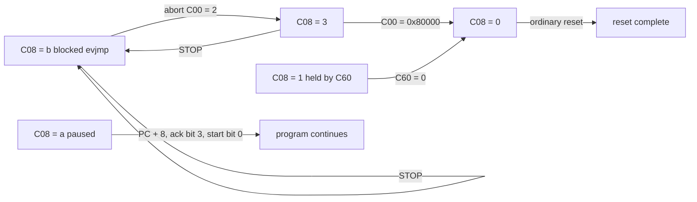

# Chapter 8 — Sequencer control registers

<a id="sequencer-control-faults-and-cpu-handoff"></a>

Summary: the registers of the sequencer's control block (`0xc00` to `0xc5c`),
the buffer handshake words `0xc60` to `0xc6c` and the parameter RAM at `0xd00`:
what each holds, who writes it and how it behaves; then the program lifecycle,
`pause`, the reset and its effects, and the states that block a reset with the
writes that release them. Offsets are relative to `mem:0x38a00000`. Source
anchors in `bl_NandReadOnly`: reset `mem:0x502c`, start `mem:0x51b8`, IRQ wait
`mem:0x51f4`, pause handling `mem:0x4d08`. Finding IDs (M2-nn) refer to
[chapter 18](18-ledger.md). The timeout length is in
[chapter 7, section 7.9](07-events-and-waits.md#timeout-length).

## 8.1 Sequencer control block

"Device" marks behaviour measured on the device, "source" use by the original
code, and "inferred" an interpretation.

| offset | name | what it is | written by |
|---|---|---|---|
| `0xc00` | `FMSS_CTRL` | start word, stop, abort and the clearing reset | CPU |
| `0xc04` | `FMSS_PROG` | bus address of the program | CPU |
| `0xc08` | `CS_STATUS` | state code; not a simple busy Boolean | read only |
| `0xc0c` | `CS_IRQ` | flags: END, fault, pause | set by hardware, acknowledged by CPU and program |
| `0xc10` | `FMSS_C10` | initialization word, stores the bits of `0xdf`; the prologue writes 1; non-zero makes END raise VIC1 line 22 | program |
| `0xc14` | `FMSS_C14` | counter/timer; ignores writes | hardware |
| `0xc18` to `0xc34` | r0 to r7 | the program's registers; r6 (`0xc30`) is `SEQ_RESULT` | CPU and program |
| `0xc38` | `FMSS_PC` | program-relative PC; a write jumps | program; CPU, also while running |
| `0xc3c` | `FMSS_C3C` | faulting offset + 8, read by the original fault handler; 32-bit storage | hardware; CPU and program |
| `0xc40`, `0xc44` | | instruction word latches | hardware |
| `0xc48`, `0xc54` | | storage words: `C48` 32 bits (any of bits 1..7 makes a `tmwait` fault, bit 0 ends it one instant early), `C54` mask `0x83f` | CPU and program |
| `0xc4c` | `FMSS_C4C` | fault vector | program prologue |
| `0xc50` | `FMSS_C50` | completion bits | hardware |
| `0xc58` | `FMSS_C58` | fault routing | program prologue |
| `0xc5c` | `FMSS_C5C` | vector-associated state | hardware |
| `0xc60`, `0xc64` | | buffer reset request / completion | CPU / hardware |
| `0xc68` | | no role found; stores the bits of 7 | CPU |
| `0xc6c` | | buffer configuration | CPU |
| `0xd00` to `0xd7c` | PRAM | 32 parameter words | CPU and program |
| `0xd80` to `0xdfc` | | read 0, drop writes | — |

Storage masks, the same for CPU and sequencer writes (M2-154, M2-191): `C10`
`0xdf`, `C3C` and `C48` 32 bits, `C54` `0x83f`, `C58` `0xd6` (M2-70), `C68` 7.
A start keeps CPU-written `C3C`, `C48` and `C54` values: after CPU writes of all
ones the program reads `0xffffffff`, `0xffffffff` and `0x83f` (M2-154). Offset
bit 9 is decoded in `0xc00..0xfff`: none of the 38 holding words of
`0xc00..0xdff` appears at +`0x200` (M2-155). `0xd80..0xdfc` read 0 and drop
program `wr`/`pst` writes, with no alias into `0xd00..0xd7c` (M2-147).

<a id="start-word"></a>

## 8.2 `FMSS_CTRL` (`0xc00`): start word and control

Values written by the original CPU driver (source):

| value | effect |
|---|---|
| `0xfff5`, `0xffb5` | start a program (`0xffb5` in the bootloader) |
| 8 | STOP |
| 2 | abort; the original reset takes this branch when `C08` = 4 |
| `0x80000` | the clearing reset step, written before the FMC reset |
| bit 0 | resume after a `pause` (the pause handler sets it) |

Start-word fields (device):

| bits | effect |
|---|---|
| 0 | start at instruction 0. The first start word after the ordinary reset, and the first after power-on, runs a program whose instruction 0 is not END; no priming start is needed (M2-151, M2-431). A plain start while a program runs is ignored (M2-158) |
| 1, 3, 16 | hold: the program stays at instruction 0, with `C00` bit 18 set, until a start word without these bits (`0xffb5` then runs it once from instruction 0); there is no single-step (M2-153, M2-157). Written while a program runs, bit 1 freezes it exactly (`C08` = 3) and a later start resumes it; bit 3 or 16 restarts it from instruction 0 after the release (M2-158). Bit 3 does not read back (M2-153) |
| 2 | timeout enable: with start word 1 an unmet `wait 3` or illegal opcode `1a` waits with `C08` = 4 and no fault (M2-56), and `evjmp` blocks in state `0xb` (M2-57) |
| 7:4 | timeout step n: 2^3 engine cycles for n = 2, 2^5 for n = 3 and 2^(n+3) for n = 4..11, saturating at n = 11; immediate for n = 0, 2 engine cycles per count for n = 1 within the 2-us resolution (M2-115, M2-216). Bit 6 acts only as part of this field (M2-201). `0xfff5` and `0xffb5` have n = `0xf` and `0xb`, both in the saturated range |
| 15:8 | timeout count: a `wait` entered at the start faults after count + 1 steps plus a fixed offset (count + 1 = 8..256; M2-81), on a grid of timeout instants whose phase the per-case reset sets before the run starts (M2-433, M2-588, M2-631); counted from its entry a `wait` of count ≥ 1 faults at instant count + 2 and a `tmwait` ends at instant count + 1, and count 0 faults at the first instant (M2-373, M2-584); `C14` holds the count after a quickly passing `wait` (M2-172; [chapter 7, section 7.9](07-events-and-waits.md#timeout-length)) |
| 17 | no observed effect (M2-201); preloaded r2..r5 survive starts with and without it (`0xfff5`, `0x20001`, `0x20000`; M2-157) |
| 19 | inhibits the start like bits 1, 3 and 16, but `C00` then reads `0x7f60`, bit 18 clear (M2-153, M2-201) |
| 18, 20..31 | no observed effect (M2-201) |

Worked example, the driver's `0xffb5`:

```
0xffb5 = 1111 1111 1011 0101
         └─15:8──┘ └7:4┘3210
```

Bit 0 = 1 (start), bit 1 = 0 (no hold), bit 2 = 1 (timeout enabled), bit 3 = 0,
bits 7:4 = `0xb` (n = 11: step 2^14 cycles ≈ 492.7 us), bits 15:8 = `0xff`
(count 255). An unmet `wait` faults after 492.747 us × 256 + 447.5 us ≈ 126.6 ms
(M2-81). `0xfff5` differs only in n = `0xf`, which saturates to the same step;
`0x07b5` (count 7) faults after ≈ 4.39 ms.

Raw readbacks (device; concrete observations, not a bit map):

| state | `C00` reads |
|---|---|
| running; at a `pause` | `0x4ffb4` (M2-384) |
| running after a timeout fault (in the fault handler, or continuing with `C58` = 0), start word `0x01b5` | `0x401b4` (M2-384) |
| held by start bit 1, 3 or 16; a `wait` held by start word 1 | bit 18 set; `0x40000` (M2-153, M2-384) |
| start inhibited by bit 19 | `0x7f60` (M2-153) |
| after STOP, while a loop runs or in the blocked `evjmp` state | `0x40000` (M2-392, M2-422) |
| after abort (`C00` = 2) | `0x40002` (M2-392, M2-422) |
| after the clearing step `0x80000`, alone or after STOP or abort | `0x7f60` (M2-392, M2-422) |
| after `0x80000` followed by STOP | 0 (M2-392, M2-422) |
| held by `C60` = 1 | `0x407b4` |
| at power-on, and in the untouched window after a probe cleanup | `0x7f60`, against the last start word `0xffb4` after the ordinary reset (M2-281, M2-430) |

While a program runs, waits, is held by start word 1 or stops at a `pause`, `C00` reads the start word with bit 18 set and bit 0 clear (M2-384).

Other start words are not qualified.

## 8.3 `FMSS_PROG` (`0xc04`)

The bus address of the program, written by the CPU before the start (source;
every successful probe). A paused program can be redirected by changing it
([section 8.20](#pause-12-and-recovery)). STOP preserves it; the clearing step
clears it (M2-54, M2-422). It reads 0 at power-on and in the window left by a
probe cleanup (M2-281, M2-430).

## 8.4 `CS_STATUS` (`0xc08`)

A state code (device, CPU reads unless noted):

| value | state |
|---|---|
| 0 | idle; at power-on; after every END, also a fault-handler END; after STOP, and after the clearing step (M2-53, M2-62, M2-384, M2-422, M2-430) |
| 1 | running: a delay loop, a fault handler after a vectored timeout fault (`C58` = 4; `C5C` = 1) or a program running on after a `C58` = 0 fault, the value varying with 2 and 9 between identical runs (M2-384); in every run of an `ld` loop and one of three of an `sti` loop (M2-693); also the state held by `C60` = 1 ([section 8.22](#blocked-states)) |
| 2 | running, as 1; in one of three runs of a `nop2` loop (M2-384, M2-693) |
| 3 | after abort (`C00` = 2), from a running loop or the blocked `evjmp` state (M2-62, M2-392, M2-422); a running program frozen by start-word bit 1 (M2-158) |
| 4 | waiting: every unmet `wait`, a `wait2`, a `tmwait`, a `nop` with R ≥ 8 and a `wait` held by start word 1, read inside the state (M2-384, M2-685), or stalled on an illegal opcode; the original reset takes its abort branch for 4 |
| 5 | the value the program itself reads (sequencer-side read) in every tested state, also with a DMA, ECC operation or command in progress (M2-70, M2-112, M2-384) |
| 8 | running: read in two of three runs of an `sti` loop (M2-693) |
| 9 | running, as 1: read in one run-on and one fault-handler run and in two of three runs of a `nop2` loop, not a separate state (M2-384, M2-693) |
| `0xa` | stopped at `pause` (`12`) (M2-14, M2-384) |
| `0xb` | `evjmp` waiting for its event (M2-384); blocked with the timeout disabled, where it survives STOP (M2-57) |

Read once 3 ms into a 400 ms loop of one instruction kind, three runs each, `C08` gives 0x9, 0x9, 0x2 for `nop2`, 0x8, 0x1, 0x8 for `sti` and 0x1, 0x1, 0x1 for `ld` (M2-693). Sampled continuously by the CPU during a run it changes within one loop: 1, 2 and 9 in ALU and `nop2` loops, also 7 in an SDRAM-access loop and 5 in a window-access loop, 4 in an unmet wait (M2-719). The running value varies between identical runs of one kind; the CPU takes one read per run at an instant whose phase within the loop it does not control, so the values cannot be assigned to an instruction or a pipeline step ([chapter 17](17-open-questions.md), item 8).

## 8.5 `CS_IRQ` (`0xc0c`)

| bit | set when (device) |
|---|---|
| 0 | the program reached END |
| 1 | `sig` (`10`) executed; the program continues; cleared by writing 2 (M2-34, M2-65, M2-370) |
| 2 | a fault (timeout or illegal opcode) |
| 3 | the program is stopped at `pause` |
| 4 | an FMC flag routed by `0x044` was raised during the run; stays set after the flag's acknowledgement (M2-200) |
| 5, 6 | never set after BCH8 encodes and decodes, with `0x044` = 0 or all ones and every tested ECC enable candidate (M2-212) |

- `CS_IRQ` = 5 is fault plus END: a fault handler that reaches END, not a clean
  program result. `CS_IRQ` = 4 (fault without END) remains when the engine is
  held by `C60` = 1 after its timeout vector.
- The original code writes the flags to acknowledge them. The original pause
  handler acknowledges bit 3.
- `sig` sets bit 1 in every tested operand form in idle, DMA and ECC states
  (`CS_IRQ` = 3 at END; M2-34, M2-65, M2-370). Writing 2 clears the bit and the
  next `sig` sets it again; `sig` raises no VIC0 or VIC1 raw line beyond the run
  baseline (M2-370).
- A CPU write to `C0C` during a `wait` releases none of `wait` events 6..10,
  12..15 (M2-120).

## 8.6 `FMSS_C10` (`0xc10`)

The original program prologue writes 1. `C10` stores the bits of `0xdf`
(M2-191). VIC1 raw bit 22 is set at the stop after a run that executed an END
(a fault-handler END included) with `C10` non-zero (1 or `0xdf`), and clear
after an END with `C10` = 0 and after every run that stops without an END
(held, paused, looping, or faulted with no handler END); it is clear while a
program runs (M2-182). Presets of 0 or all ones change neither the `wait`
timeout, a `tmwait`, a DMA nor the BCH8 parity (M2-179). STOP and abort
preserve `C10` = 1; the clearing step clears it (M2-54, M2-422). A CPU write
during a `wait` releases no event (M2-120).

## 8.7 `FMSS_C14` (`0xc14`): counter/timer

| observation (device) | `C14` |
|---|---|
| at power-on; after STOP, after the clearing step, after the ordinary reset and in the window left by a probe cleanup | `0x7f` (M2-281, M2-430) |
| before the first `wait` of a run (also the sequencer's own read at the start) | `0x7f` (M2-177, M2-384) |
| after a `wait` that passes before the first timeout step (DMA, encode, `wait` 0..5 and 11, `wait2 5`, an `evjmp` departure) | start-word bits 15:8: `0xff` for `0xffb5`, `0xfe` .. `0x7f` with one of bits 8..15 cleared, `0x07` for `0x07b5`, `0xef` for `0xefb5` (M2-172) |
| about 1 ms after such a `wait`, through later passing waits and after the END (CPU read) | the loaded value, unchanged (`0xef` for `0xefb5`; M2-172) |
| while a `wait` or a `tmwait` stalls | counts down by one per timeout step: `0xbd` 33 ms into a second `wait` after a fault, `0xbc` 34 ms into a second `tmwait` (start word `0xffb5`) (M2-172) |
| at the end of a short observation of a running `tmwait` | `0x35` (M2-13) |
| after a timeout fault, whatever the start word (ten start words, fault times following bits 15:8) | `0x7f` (M2-177) |
| after a `wait 0` released by a CPU `70h` write after one or more timeout steps (1, 2 or 4 steps for counts 3, `0x10`, `0x40` with n = `0xb`, and count `0x10` with n = 9; 1..120 ms into it with `0xffb5`), also 1 ms later, and after a `wait 5` that passed at an erase end 2.27 ms into it | `0x7f` (M2-177) |
| after a loop of `nop` (`08`, R = 0) with start word `0xffb5` | `0xff`, start-word bits 15:8, as after a passing `wait 11` (M2-625) |
| after a completed `tmwait` | 0 (M2-27, M2-373, M2-584) |
| after a CPU write of `0x55` or program writes of `0x12`, 0, `0xff`, `0x33` | unchanged (`0x7f`) (M2-176) |

A `wait` loads `C14` with start-word bits 15:8 and `C14` counts down by one per
timeout step while the wait stalls; a wait that passes before the first step
leaves the loaded value, which `C14` keeps until the next wait, one that ends
after one or more steps (by its timeout or by its event, also a release 1.5 ms
in) leaves `0x7f`, and a run without a passing `wait` leaves the initial `0x7f`
(M2-172, M2-177). The sequencer reads `0x7f` before a passing `wait` and the
loaded value right after it (M2-172); that a stalled wait also loads at its
entry is inferred from its count-down. `C14` ignores CPU and program writes, which also leave the
`tmwait` time unchanged (M2-176, M2-629). The value `0x7f` after a stalled
wait is the same for every tested count, step field and number of steps,
and equals the power-on and reset value (M2-177, M2-430); whether it is a
fixed constant or a value held elsewhere is not separable, since `C14` ignores
writes ([chapter 17](17-open-questions.md), item 8). Consecutive `tmwait`s each wait a
full period; a `tmwait` started with `C14` = 0 does not reload and end at once
(M2-150).

## 8.8 r0 to r7 (`0xc18` to `0xc34`)

The eight GPRs; r6 (`0xc30`) is `SEQ_RESULT` (M2-02). Its value is defined by
the program's ABI, not a universal hardware error code
([chapter 12](12-cpu-interface.md)). STOP preserves the GPRs, the clearing step
clears them (M2-53, M2-54).

## 8.9 `FMSS_PC` (`0xc38`)

The program-relative PC.

- At a `pause` it stays on the `pause` instruction; the original pause handler
  advances it by one eight-byte instruction (source; M2-14).
- STOP sets it to 0 (M2-53). The blocked `evjmp` state shows the offset of the
  `evjmp` (`0x20`, `0x38` in the measured programs; M2-57, M2-392), and the
  clearing step returns it to 0 (M2-392).
- It is register r8: a `movi r8` with a local target lands there, and
  `mov r2, r8` returns the instruction's offset (M2-38, M2-43).
- A program `wr` or `st` to `0xc38` jumps to the written offset; the
  fall-through instruction is not executed. An `ld` of `0xc38` reads the
  instruction's own offset (M2-162).
- CPU writes take effect outside a pause: written before the start, the
  program starts at the written offset; written while a loop runs, the program
  jumps there; written during an unmet `wait 3`, the `wait` still times out and
  the run continues at the written offset (M2-278).

## 8.10 `FMSS_C3C` (`0xc3c`)

In a fault handler `C3C` holds the faulting instruction's offset + 8, also for
a nested fault (waits at `0x28`, `0x40`, `0x70` give `0x30`/`0x88`,
`0x48`/`0xa0`, `0x78`/`0xd0`); it reads 0 after the run (M2-179). It stores
32 bits from the CPU and the sequencer, and a start keeps a CPU-written value
(M2-154). Presets of 0 or all ones change neither the `wait` timeout, a
`tmwait`, a DMA nor the BCH8 parity (M2-179). The sequencer reads 0 at the
start of a run (M2-384). The original fault handler reads it.

## 8.11 `0xc40` and `0xc44`: the held instruction

Instruction word latches: an `end` latches R << 16 | arg in `C40` and its imm
in `C44` (M2-164). They show the encoded words of a held `pause` (`12`)
and `tmwait` (`15`), `C40` = `0x0e060000` / `C44` = `0x20` in a local BNZ loop
before the clearing step, and `C40` = `0x07060000` (the `wait`) in the `C60`
hold. STOP and abort preserve them (they hold the last instruction); the
clearing step clears them (M2-54, M2-422).

## 8.12 `0xc48` and `0xc54`

Storage words: `C48` holds 32 bits and `C54` the bits of `0x83f`, from the CPU
and the sequencer, and a start keeps CPU-written values (M2-154). Presets of 0
or all ones change neither the `wait` timeout (4388..4393 us at count 7), a
DMA in, the BCH8 parity nor a DMA out. A `tmwait` ends at 3879..3900 us with
`C48` = 0 and with every preset of `C10`, `C3C` and `C54`, but with `C48` =
`0xffffffff` or `0x55555555` it does not end after its period and faults at
the `wait` timeout (4388..4390 us) instead, in every run (M2-179). With a
count-1 `tmwait`, `C48` = 0 and each single bit 8..31 let it end at
941..943 us with `C14` = 0, `C48` = 1 ends it one timeout instant earlier
(449 us, `C14` = 1), and each single bit 1..7 and `0xaaaaaaaa` make it fault at
the `wait` timeout (1434..1436 us) (M2-627). With a count-7 `tmwait`, `C48` =
v = 1..7 ends it v timeout instants early (3406 .. 449 us against 3896 us for
`C48` = 0) with `C14` = v, and `C48` = 8 makes it fault at the `wait` timeout
(4390 us) (M2-687). `C48` bits 7:0 are the compare value of `tmwait`: it ends
at the instant at which its `C14` count equals them, never when they exceed
the count, and bits 31:8 do not act on it (M2-627, M2-688). `C54` has no observed effect. CPU
writes during a `wait` release none of `wait` events 6..10, 12..15 (M2-120,
M2-143).

## 8.13 `FMSS_C4C` (`0xc4c`): the fault vector

The byte offset of the fault handler, written by the original programs. A fault
with `C58` bit 2 set continues there, and `evjmp` continues there after its
event for every tested `C58` value (0, 2, 4) (M2-58, M2-186). No END continues there: no `C58`
value diverts an END to `C4C` (M2-149). STOP preserves it; the clearing step clears it (M2-54).

<a id="c50"></a>

## 8.14 `FMSS_C50` (`0xc50`): completion bits

| bit | set by (device) |
|---|---|
| 0 | command flag (`wait` event 0) pending |
| 1 | address flag (event 1) pending |
| 2 | DMA flag (event 2) pending |
| 3 | data or parity transfer flag (event 3) pending |
| 4 | ECC completion (event 4) pending |
| 5 | status-latch flag (event 5) pending |
| 6, 8 | never set, also after a command written through `+0x408` (M2-183, M2-209) |
| 11, 12 | read 1 while the ECC engine is idle, 0 while it works (M2-112) |

- Bits 0..5 mirror pending `wait` events 0..5: an operation's bit is set while
  its flag is pending and clears with the flag's acknowledgement (M2-112,
  M2-209).
- Bit 0 after a `70h` write: clear in the first two sequencer reads after the
  write, set from the third instruction after it, kept through a timeout fault
  and a write of 1, and cleared by the `FMC_STATUS` bit 1
  acknowledgement. It is not set without a command or after an acknowledged one
  (M2-152).
- Idle value `0x00ff1800`, unchanged before and after the fault handler writes
  1, in both the no-fault and the faulting handler controls (M2-18, M2-28).
  After a status latch it read `0x00ff1820`.
- The original fault handler reads bit 0 and writes 1 (source).
- Bit 4 stays set after `0x810` = 1, which does not acknowledge the ECC
  completion; bit 5 clears with `FMC_STATUS` = `0x1800000`
  ([chapter 7, section 7.3](07-events-and-waits.md#consumption-and-acknowledgement)).

<a id="c58"></a>

## 8.15 `FMSS_C58` (`0xc58`): fault routing

- A write reads back as value AND `0xd6`, from the CPU and from the sequencer:
  zero, all ones and every single bit, 68 cases (M2-70). Bit 0 is not stored:
  `C58` = 1, 3, 5, 7 read back 0, 2, 4, 6 (M2-148).
- Bit 2 set: a timeout continues at the fault vector; clear: at the next
  instruction, after about the same timeout (idle `wait 1` sweep; M2-11).
- No `C58` value diverts an END to `C4C`: `C58` = 0..7, `0x12` and `0x16`, with
  `C4C` written by the CPU (before or after `C58`) or by the program, and
  `C58` = 2 and 6 in every write order, end at the fall-through END with
  `C5C` = 0 (M2-149). An END with bit 0 written leaves `C5C` = 0 and runs no
  fault vector (M2-148); bit 0 does not select start-at-vector (M2-12).
- `evjmp` jumps to `C4C` after its event for `C58` = 0, 2 and 4; with no event
  it times out and then follows bit 2 like a `wait` (M2-186).
- Bits 1, 4, 6 and 7 are stored and change neither the timeout path nor the
  handler: with `C58` = `0x40`, `0x80` or `0xc0` a timeout continues at the
  next instruction, with `0x44` or `0x84` it vectors to `C4C`; with 0, 2,
  `0x10` or `0x12` an unmet `wait 3`, a count-0 `tmwait` and the undefined
  opcode `1a` continue after the fault (`C5C` 0), with 4, 6, `0x14` or `0x16`
  they vector (`C5C` 1); bit 2 alone decides (M2-612).
- The original programs write it in their prologue.

## 8.16 `FMSS_C5C` (`0xc5c`)

Timeout-vector cases end with `C5C` = 1, ordinary continuation cases with 0;
`C5C` reads 1 while the fault handler runs (M2-384). An END, whatever `C58`
holds, leaves `C5C` = 0 (M2-148, M2-149), and the sequencer reads 0 at the start
of a run (M2-384). Its full bit map is open ([chapter 17](17-open-questions.md),
item 8).


## 8.17 Buffer handshake (`0xc60` to `0xc6c`)

- **`C60` / `C64`: buffer reset request / completion.** The original CPU
  handshake writes `C60` = 1, waits for `C64` = 1 and writes `C60` = 0 (source;
  M2-20).
- **`C60` = 1 during a run holds the engine** (M2-121). Written 1 ms into a
  `wait`, the timeout still vectors to the handler, but the engine then stays
  with `C00` = `0x407b4`, `C08` = 1, `C60` = `C64` = 1, `C40` = `0x07060000`,
  `CS_IRQ` = 4. STOP and the buffer handshake do not reset it, and the hold
  survives an emCORE reload. Writing `C60` = 0 releases it (M2-126;
  [section 8.22](#blocked-states)). Restored to 0 at 2.5 ms, while the `wait`
  is still pending, the run faults at 4.24 ms and the ordinary reset succeeds.
- **`C68`.** No role found.
- **`C6C`: buffer configuration.** The original normal path writes 0, the
  alternate bypass `0x10` (source).
- CPU writes to `C60`..`C6C` during a `wait` release none of `wait` events
  6..10, 12..15; every following reset succeeds once `C60` returns to 0
  (M2-125, M2-143).

## 8.18 Parameter RAM (`0xd00` to `0xd7c`)

`0xd00`..`0xd7c` retain 32 CPU-written words (M2-03). `0xd80`..`0xdfc` read 0
and drop CPU writes and program `wr`/`pst` writes, read back from both sides,
with no alias into `0xd00..0xd7c` (M2-04, M2-147). STOP preserves PRAM; the clearing step and the
full reset zero it (M2-49, M2-54, M2-123). Details of the windows are in
[chapter 4](04-sequencer-memory-map.md).


## 8.19 Program lifecycle

The original CPU driver places the program in coherent bus-visible RAM, resets
the engine, FMC and ECC, then initializes the parameter ABI and GPR inputs,
clears the sequencer IRQ flags, sets `C04`, completes the buffer handshake and
writes the start word (source; M2-20). The original programs initialize `C10`,
`C58`, `C4C` and the peripheral flags themselves. Starting the program,
selecting a NAND CE and starting a NAND or DMA transaction are three different
operations.

Because the clearing reset step zeroes the GPRs and PRAM, parameters are
written after the reset (M2-55; a reset after the parameters fails the native
NAND tests in emulation, M2-50).

An END sets `CS_IRQ` bit 0 and leaves the program's r6 result. A fault sets
bit 2 and vectors or continues; the handler still reaches END, which gives
`CS_IRQ` = 5.

<a id="pause-12-and-recovery"></a>

## 8.20 `pause` (`12`) and CPU resume

`pause` stops the program with `C08` = `0xa`, `CS_IRQ` bit 3, PC on the
`pause` instruction and `C00` = `0x4ffb4` (M2-14; the operand forms are in
[chapter 6](06-opcode-reference.md)).

- **Resume.** The original CPU handler advances PC by 8, acknowledges bit 3 and
  sets start bit 0. Both measured forms then reach the following marker and END
  (M2-25). The program continues after the CPU writes PC = offset + 8 and a
  start word, with or without the `CS_IRQ` bit 3 acknowledgement (11 cases);
  without a PC write it stays paused (12 cases) (M2-188). With two start words
  after the PC write the program continued in three of four runs and stayed
  paused in one (M2-512). A PC write takes
  effect outside a pause too ([section 8.9](#89-fmss_pc-0xc38); M2-278).
- **Redirect.** Writing `C04` to an END-only program, PC = 0, acknowledging and
  resuming with the normal control fields ends the paused program; the
  ordinary reset then completes (M2-26).
- **Inherited pause.** A pause inherited from an earlier run needs resume
  followed by abort (M2-26).
- **STOP.** A reset that writes STOP and waits for `C08` = 0 fails after a
  pause (M2-15); a model in which the pause persists through STOP reproduces
  the failure cascade (M2-16, inferred and emulated).


## 8.21 Reset

The original reset (`mem:0x502c`) writes STOP and waits for `C08` = 0, taking
its abort branch only for `C08` = 4; it polls the `C60`/`C64` buffer handshake
and `FMCTRL1` bit 30, each with a 100 us bound in the tested build, and writes
`C00` = `0x80000` before the FMC reset. Effects of the individual steps
(device, M2-53, M2-54, M2-123):

| step | effect |
|---|---|
| STOP (`C00` = 8) | PC = 0, `C08` = 0; preserves all eight GPRs, all 32 PRAM words, `C10` = 1, `C04`, `C40`/`C44`, `C4C` |
| STOP, then `C00` = 2, buffer `C60` 1 → 0, FMC `004` = `0x800` → `0x80000000`, or ECC `0x81c` = 1 | preserve GPRs and PRAM |
| FMC `004` = `0x80000000` (alone, after `0x800` or as `0x80000800`) | zeroes FMC `00c`, `010`, `014`, `018`, `01c`, `02c`, `030`, `034`, `058`, `05c` and sets `FMC_DMA_CTRL` to 7; `ECC_CTRL` kept (M2-645) |
| ECC `0x81c` = 1 | zeroes `ECC_CTRL`; the FMC words kept (M2-645) |
| FMC `004` = `0x800` | changes none of these words (M2-645) |
| STOP, then `C00` = `0x80000` | clears GPRs, PRAM and the non-zero `C04`, `C10`, `C40`, `C44`, `C4C`; `C14` stays `0x7f` |
| `C00` = `0x80000` alone, or in any order with STOP or abort, while a loop runs | clears r0..r7, PRAM, `C04`, `C10`, `C4C`, `C40`, `C44`; `C00` reads `0x7f60` (0 when STOP follows) (M2-422) |
| STOP, abort, or STOP then abort while a loop runs | clear nothing: GPRs, PRAM, `C04`, `C10`, `C4C` kept, `C40`/`C44` hold the last instruction; `C08` = 0 after STOP, 3 after abort (M2-422) |
| complete reset | the same as the clearing step, plus FMC `00c`..`05c` and `ECC_CTRL` read 0; `FMC_DMA_CTRL` reads 7 (M2-123) |

No `C00` sequence changes FMC `0x00c`..`0x038`, `0x058`, `0x05c` or `ECC_CTRL`
(M2-422): `FMCTRL1` bit 31 zeroes the FMC words and sets `FMC_DMA_CTRL` to 7,
and `0x81c` = 1 zeroes `ECC_CTRL`, from CPU and sequencer writes alike; these
two steps account for the zeroing of the complete reset (M2-123, M2-645); no
measurement writes the `C60`/`C64` handshake on its own.

**Power-on.** The window at power-on (first access after a power cycle) equals
the window after the ordinary reset in every word of `0x000..0xffc` except
`C00` (`0x7f60` at power-on, the last start word `0xffb4` after the reset) and
`C04` (0 at power-on, the program address after the reset); it equals word for
word the untouched window left by a probe cleanup (M2-281, M2-430). Power-on
values include `C14` = `0x7f`, `C08` = 0, `C50` = `0x00ff1800`, `CS_IRQ` = 0,
`FMC_DMA_CTRL` = 7, `FMC_STATUS` = `0xc3000`, `0x1cc` = `0x8060`, `0x1d0` =
`0x3010d0`, `0x808` = `0x700` and `0x810` = `0x10`, with every GPR and PRAM
word 0 (M2-430). The ordinary reset therefore reproduces the power-on state
apart from `C00` and `C04`, and the first program after power-on whose
instruction 0 is not END runs on its first start, with no priming start
(M2-431).

<a id="blocked-states"></a>

## 8.22 States that block the reset and their release

| state | signature | release | cleanup method code | findings |
|---|---|---|---|---|
| paused | `C08` = `0xa`, `CS_IRQ` = 8 | resume or redirect (section 8.20); inherited: resume and abort | 1; 3 | M2-25, M2-26 |
| waiting with the timeout disabled | `C08` = 4, no fault | ordinary reset | — | M2-56 |
| blocked `evjmp` with the timeout disabled | `C08` = `0xb`, PC = the `evjmp` offset, `CS_IRQ` = 0; STOP leaves `0xb`, reset phase 1 fails | abort `C00` = 2 (→ `C08` = 3), then `C00` = `0x80000` before another STOP (→ 0), then the ordinary reset (phase 6, rc 0) | `0x01000318` | M2-57, M2-59, M2-60, M2-62, M2-63 |
| status transaction active after END | reset phase 4 (FMC acknowledgement) fails with `FMCTRL1` = 2 | `FMCTRL1` = `0x30020`, `FMC_STATUS` = `0x1800000`, another reset | 4 | M2-29, M2-31 |
| held by `C60` = 1 | `C08` = 1, `C60` = `C64` = 1, STOP ineffective | `C60` = 0, wait for `C08` 0 or 3, abort and `C00` = `0x80000` if needed, then the complete reset | `0x20` (`0x40` with the fallback) | M2-121, M2-126 |



- **Blocked `evjmp`.** A STOP written after the abort, without the clearing
  step, returns the engine to `0xb` (M2-60). With the sequence of the table,
  both an inherited state and a fresh zero-field `evjmp` with `C00` = 1 reach
  `C08` = 0; the full reset and the next independent marker (END, `CS_IRQ` = 1,
  r2 = `0x72657365`) succeed. These recoveries take 107 us and 106 us, including
  the initial failed STOP poll (measured durations, not a timing
  specification).
- **Status transaction.** An active FMC status transaction survives the
  sequencer's END. A program that latches status, faults at its `wait` and
  reaches its handler's END (r6 = `0xfa17fa17`, `CS_IRQ` = 5, `C08` = 0;
  `FMCTRL1` = `0xa`, `FMC_STATUS` = `0x008c3000`, `C50` = `0x00ff1820`) leaves
  a reset that fails at stage 4 with `C08` = 0 after 102 us. Two-latch programs fail
  reset phase 4 with `FMCTRL1` = 2 and recover with the release of the table;
  each following marker reaches END. Sequencer status alone does not identify
  which peripheral handshake failed ([chapter 9](09-nand-controller.md)).
- **Coverage.** In one full execution of all families (31,001 sampled records) no setup,
  reset or cleanup failed (M2-64): the blocked-`evjmp` release ran 16 times,
  the status release 1,342 times, pause resume 197 times and pause resume with
  abort once; the ordinary reset handled the rest (M2-75). 23 of those records
  skip the reset/preflight explicitly; they are not separately measured resets.
- **`C00` orders on a blocked `evjmp`.** CPU writes 1 ms and 2 ms into a
  blocked start = 1 zero-field `evjmp` leave: STOP `C08` = `0xb` (`C00`
  `0x40000`); abort `C08` = 3 (`C00` `0x40002`); STOP then abort 3; abort then
  STOP `0xb`; `0x80000` alone or after STOP or abort `C08` = 0, `C00`
  `0x7f60`, PC 0; `0x80000` then STOP `C08` = 0, `C00` = 0. Every sequence
  containing the clearing step reaches `C08` = 0, and the reset that follows
  recovers the engine in all eight (M2-62, M2-392).

References: [chapter 14](14-evidence.md) (outcomes), [chapter 13](13-experiments.md)
(experiments), [chapter 15](15-evidence-interpretation.md) (interpretation),
[chapter 16](16-device-findings.md) (device findings), [chapter 18](18-ledger.md)
(findings).

Related chapters: [chapter 2](02-architecture.md), [chapter 3](03-cpu-memory-map.md),
[chapter 6](06-opcode-reference.md), [chapter 7](07-events-and-waits.md),
[chapter 9](09-nand-controller.md), [chapter 12](12-cpu-interface.md).
