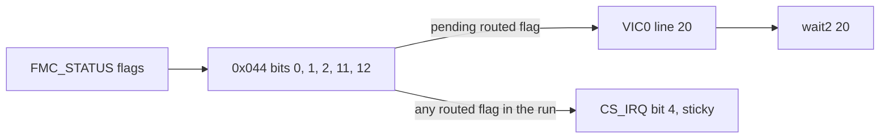

# Chapter 9 — NAND controller, buffers and DMA

Summary: The registers of the NAND controller (FMC) that the sequencer drives:
the configuration word, the operation trigger, the command/address/data
registers, DMA, the status latch, the `FMC_STATUS` flags, the interrupt enable,
the FIFO, the `+0x400` range, the bus timing and the `0x100` block.
The sequencer itself is described in chapters 2 to 8; the ECC registers at
`0x800..` are in [chapter 10](10-ecc-engine.md#ecc-engine-and-codeword-layout).

Register names follow M1 (M1 chapter 9).
Meanings come from original-code use (chiefly `bl_NandReadOnly` READ at
`mem:0x6438` and READID at `mem:0x7550`) and from device measurements cited by ledger ID
([chapter 18](18-ledger.md#m2-finding-and-documentation-ledger)).

## 9.1 Register map

| Offset | M1 name | Fields and behaviour | Evidence |
|---|---|---|---|
| `0x000` | `FMC_CTRL0` | configuration word, fields in [section 9.2](#92-fmc_ctrl0-0x000-configuration-word); storage mask `0x77077fff` | S, D: M2-127, M2-131, M2-135, M2-139, M2-191 |
| `0x004` | `FMCTRL1` | operation trigger/reset; distinct from sequencer `C00`; codes in [section 9.3](#93-fmctrl1-0x004-operation-codes) | S |
| `0x008` | `FMC_CMD` | NAND command byte: `ff` reset, `90` ID, `00`/`30` read, `70` status; write programs also use `80`/`10` and `60`/`d0` | S |
| `0x00c` / `0x010` | `FMC_ADDR0` / `FMC_ADDR1` | packed address bytes; a page at column zero uses `row << 16` and `row >> 16`; storage mask 32 bits each | S; D: M2-83 |
| `0x014` | `FMC_DATA_SEL` | data-buffer selection: source uses `0x10` for the FIFO, `0x102` / `0x201` for the alternating buffers; a status latch returns the chip status with `0x100`, `0x200` or 1 selected ([section 9.6](#96-status-latch-and-fmc_nstat-0x04c)); storage mask `0xffff`; `0x058` is its bits 7:0 and `0x05c` its bits 15:8, so a later `0x058` write replaces bits 7:0 (`0x5541` then `0x058` = `0xd` reads `0x550d`, for sequencer and CPU writes alike); a DMA in flight follows a rewrite from the next bytes on, and of the tested values a DMA in writes data buffer 0 only with 1 and parity buffer 0 only with `0x10`, a DMA out delivers data buffer 0 only with `0x100` ([section 9.5](#95-dma)) | S; D: M2-83, M2-169, M2-196, M2-603, M2-643, M2-668, M2-702 |
| `0x018` | — | source writes 1 before data reads; storage mask `0xf` (it reads the written value & `0xf`); 1 before a data read changes neither page-read data nor ECC results, and 1, 2, 3 or `0xff` leave a 512-byte buffer loopback exact; role unresolved | S; D: M2-83, M2-104, M2-405 |
| `0x01c` | — | ECC slot selection: stores bit 0 only, and an encode uses the slot that bit selects ([chapter 10, section 10.2](10-ecc-engine.md#102-registers)) | S; D: M2-83, M2-417 |
| `0x024` | — | reads 8 after an 8-byte READ ID transfer (the number of bytes transferred; one transfer size measured) | D: M2-336 |
| `0x028` | — | 9-bit storage word (`0x5a5` written by the sequencer reads `0x1a5` from both sides); no counter: it does not advance over commands, chip reads, DMAs, ECC encodes, `FMC_FIFO` reads or `pld`/`sti`/`ldi` loops, and does not drift between runs | D: M2-156, M2-173, M2-199 |
| `0x02c` | `FMC_ANUM` | address cycles minus one; storage mask `0x7`; a four-cycle erase uses 3 | S; D: M2-83, M2-168 |
| `0x030` | `FMC_DNUM` | NAND transfer byte count minus one (`0x1ff` for a 512-byte sector); storage mask `0x1fff`; a DMA moves 512 bytes whatever it holds | S; D: M2-83, M2-189 |
| `0x034` | `FMC_DMA_ADDR` | DMA bus address; original READ writes it once per 2 KiB chunk; storage mask 32 bits; a DMA in flight follows a rewrite from the next bytes on ([section 9.5](#95-dma)) | S; D: M2-83, M2-603 |
| `0x038` | `FMC_DMA_CTRL` | DMA control; original M2 READ never writes it; reads 7 after reset; bits 12:6 change during a DMA; bits 2:0 set its speed (burst length inferred); bits 5:3 stored, a DMA out completes only with bits 5:3 = 0 or 1; bits 31:13 not stored; details in [section 9.5](#95-dma) | S; D: M2-76, M2-79, M2-113, M2-117, M2-123, M2-396, M2-398, M2-609, M2-669, M2-699, M2-700, M2-701 |
| `0x040` | — | FIFO/metadata command: `0x52` ID latch, `0xc2` corrected-metadata latch, `0xc1` metadata input. After `0x52` it reads `0x50`, after `0xc1` it reads `0xc0` | S; D |
| `0x044` | — | interrupt routing of the controller's flags: bits 0, 1, 2, 11, 12 = command, address, transfer, DMA, status latch ([section 9.8](#98-interrupt)) | D: M2-142, M2-200 |
| `0x048` | `FMC_STATUS` | completion and state flags, acknowledged by writing masks ([section 9.7](#97-fmc_status-flags)) | S; D: M2-66, M2-112, M2-145, M2-203, M2-412 |
| `0x04c` | `FMC_NSTAT` | latched NAND status byte ([section 9.6](#96-status-latch-and-fmc_nstat-0x04c)); distinct from the sequencer IRQ; writes of 0 and all ones are ignored | S; D: M2-87, M2-136, M2-412 |
| `0x058` | — | `FMC_DATA_SEL` bits 7:0: a write replaces them and a read returns them (the source writes `1`, `0x10`, `0x20`, which select the data or parity buffer through `FMC_DATA_SEL`); storage mask `0xff`; it reads 0 after a buffer loopback because the loopback's DMA out leaves `FMC_DATA_SEL` = `0x100`, and a later `FMC_DATA_SEL` write replaces a value written before it (a DMA in with `FMC_DATA_SEL` = 0 written after 058 = 1, 2, `0x10` or `0x20` therefore changes neither data buffer) | S; D: M2-83, M2-405, M2-597, M2-599, M2-643 |
| `0x05c` | — | `FMC_DATA_SEL` bits 15:8 in place: a write sets them (its bits 7:0 are not stored) and a read returns `FMC_DATA_SEL` & `0xff00`; the source writes `0x200` (data buffer 1 out) before the final DMA; it reads `0x100` after a buffer loopback (the loopback's last select), a CPU-written `0x200` reads back unchanged; `0x100`..`0x3ff` leave the loopback exact, and `0x200` changes neither page-read data nor ECC results | S; D: M2-83, M2-104, M2-405, M2-599, M2-643 |
| `0x060` / `0x064` / `0x068` | `FMC_META0..2` | FIFO/metadata data words; READ ID bytes appear in `0x060`/`0x064` ([section 9.9](#99-fifo-and-read-id)) | S; D: M2-124 |
| `0x080` | `FMC_FIFO` | CPU FIFO read port (restore OS `mem:0x0802a640`); CPU reads after a data read deliver page data; sequencer reads return 0 with or without the `0x52` latch and from DMA-filled buffers; writes never reach a data buffer ([section 9.9](#99-fifo-and-read-id)) | S; D: M2-124, M2-207, M2-341, M2-436, M2-617 |
| `0x100..0x1fc` | — | block of unknown function; sequencer-writable words only at `0x1b8..0x1d8` ([section 9.12](#912-the-0x100-block)) | D: M2-160, M2-210 |
| `0x200..0x3fc` | — | copy of `0x000..0x1fc`: offset bit 9 is not decoded below `0x400` | D: M2-155 |
| `0x400..0x7fc` | — | read 0; no second register set operates there ([section 9.10](#910-the-0x400-range)) | D: M2-82, M2-139, M2-155, M2-183, M2-185, M2-393 |

Reset state: the per-case reset zeroes `0x00c..0x05c` and leaves
`FMC_DMA_CTRL` reading 7 (M2-123); the step that does so is `FMCTRL1` bit 31
(`0x80000000`), which zeroes `0x00c`, `0x010`, `0x014`, `0x018`, `0x01c`, `0x02c`, `0x030`,
`0x034`, `0x058` and `0x05c` and sets
`0x038` to 7, while `FMCTRL1` `0x800` changes none of them (M2-645). The power-on values are the same: `0x004`
reads `0x40000000`, `0x020` `0x7f167f`, `0x038` 7, `0x048` `0xc3000`, and the
other storage words 0 (M2-430).

## 9.2 `FMC_CTRL0` (`0x000`): configuration word

| Bits | Meaning | Evidence |
|---|---|---|
| 0 | data-path enable: with bit 0 clear, a data transfer does not complete and delivers no data | D: M2-135 (role inferred) |
| 8:1 | chip enables | S |
| 9, 10 | stored; toggling changes neither read time nor data | D: M2-135, M2-139 |
| 11 | set in the measured base word; toggling changes neither read time nor data | D: M2-135 |
| 14:12 | timing field, part of the cycle ([section 9.11](#911-bus-timing)) | D: M2-127, M2-131 |
| 15 | not implemented (reads 0) | D: M2-139 |
| 18:16 | timing field, part of the cycle; also places the read latch: values ≤ 1 shift read data by one byte | D: M2-127, M2-131 |
| 19..23 | not implemented (read 0) | D: M2-139 |
| 24 | DMA enable: a DMA programmed while it is clear is held (no byte moves, `wait 2` times out, `FMC_STATUS` bit 20 clear, `0x03c` static) while NAND-to-buffer transfers complete; setting it starts the held DMA with the `FMC_DMA_ADDR` value at that moment; set, DMA is exact ([section 9.5](#95-dma)) | S; D: M2-184, M2-251, M2-338 |
| 25, 26 | stored; toggling changes neither read time nor data | D: M2-135, M2-139 |
| 27 | not implemented (reads 0) | D: M2-139 |
| 30:28 | stored; no measured effect on command, address, data in/out, status latch, page open or the completion times of a command, a latch, an address-to-data read and a command after ready | D: M2-127, M2-131, M2-135, M2-139, M2-407 |
| 31 | not implemented (reads 0) | D: M2-139 |

The storage mask is `0x77077fff`, the same for CPU and sequencer writes
(M2-191). No `FMC_CTRL0` bit makes the `+0x400` words hold values (M2-139).

## 9.3 `FMCTRL1` (`0x004`): operation codes

Words used by the original programs (S):

| Code | Operation |
|---|---|
| `0x1` | address cycles |
| `0xe2` | data read |
| `0x42` | first-sector data read |
| `0x12` | parity/metadata into ECC |
| `0x100` / `0x180` | DMA out; `0x180` is the final-transfer variant |
| `0xca` | status polling (latch) |
| `0x20` | status release (CPU/boot-read code) |
| `0x10020` | status release (READ) |
| `0x30020` | status release (WRITE/ERASE) |
| `0x033338e0` | initial setup |

Single bits, each written alone with `FMC_DNUM` 15, `FMC_DATA_SEL` 1 and no CE
selected (D, M2-411):

| Bit | Operation started | Flags |
|---|---|---|
| 0 | address operation | `C50` bit 1 at once, `FMC_STATUS` bit 2 |
| 1 | data read | `C50` bit 3; `FMC_STATUS` `0xc3000` → `0x8041008` (bits 3 and 27 set, 13 and 19 cleared) |
| 8, 9 | DMA | `FMC_DMA_CTRL` counting at once, then `FMC_STATUS` bit 20 and `C50` bit 2 |
| other 28 bits | none alone | no change of `0x048`, `C50`, `0x038`, `0x04c`, `C08`, `0x810` |

What the source words do beyond these single bits (`0xca`, `0x20`/`0x30020`,
`0x340`, the set-up word as combinations) is known only as whole words
(`0x340`: [section 9.9](#99-fifo-and-read-id)).

**Replacing an operation.** An `FMCTRL1` operation written before the previous
one completes suppresses the previous operation's completion flag but not its
data (M2-332). `0x100` (DMA out of buffer 0) replaced at once by `0xe2` (chip
read into a buffer) still delivers 497..509 of the 512 bytes to RAM (a run of 4..16
bytes ending at byte 23 reads 0), and after 1, 4 or 16 delay loops all 512, but `FMC_STATUS` bit 20
never sets and `wait 2` times out; after 64 loops, with the DMA complete, both
operations complete. The replacing read completes (bit 3, `wait 3` passes) only
when `FMC_DATA_SEL` is switched to 2 before the `0xe2` write. A read replaced at
once by a DMA loses the read's flag while the DMA completes. The serial order
(DMA, `wait 2`, acknowledge, read, `wait 3`) is exact.

## 9.4 Command, address and data transfer

A command is one write of `FMC_CMD`; it sets `FMC_STATUS` bit 1. An address
transfer sends `FMC_ANUM` + 1 bytes from `FMC_ADDR0`/`FMC_ADDR1` after
`FMCTRL1` = 1 and sets bit 2. A data or parity read moves `FMC_DNUM` + 1 bytes
into the selected buffer and sets bit 3 (M2-112). Data-in (a 512-byte transfer
after `80h` + address) uses the same per-byte cycle as data-out (M2-131).

Programs on CE0 and CE1 (single raw and ECC pages, four and eight pages per
run, one page on each CE in one run) and erases on CE0 and CE1 read back
exactly: erased pages are all `0xff`, and the status after each is `0xe0`
(M2-194). A two-plane program (`80h`, row of block 3000, data, `11h`, ready,
`81h`, row of block 3001, data, `10h`, ready) reads back exactly on both
blocks, and a two-plane erase (`60h`, row, `60h`, row, `D0h`, ready) leaves
both pages all `0xff`, with status `0xe0` after each (M2-339). A four-cycle erase (`FMC_ANUM` = 3) erases the block on CE0 and CE1
with FAIL clear, in the same time as the three-cycle erase (M2-168).

The original read program alternates two sector-buffer selections and two ECC
slots (M2-21). It can issue a page on one CE while waiting for another and
transferring a previous page. These are distinct levels of concurrency: CE
scheduling, NAND-to-buffer transfer, ECC processing, and buffer-to-system-memory
DMA. The driver groups DMA pointers in 2 KiB chunks although ECC is
sector-based; a chunk is a software transfer grouping, not another physical
NAND page.

Metadata and parity travel through selections separate from the 512-byte data
buffer. FIFO/latch commands expose some of these bytes to the CPU/sequencer.
The source selectors do not establish arbitrary buffer sizes. `0x058` is
`FMC_DATA_SEL` bits 7:0 (M2-643); a DMA in with `FMC_DATA_SEL` = 0 changes
neither data buffer (M2-597, M2-668); slot selection and arbitration are in
[chapter 10, section 10.2](10-ecc-engine.md#102-registers) (M2-417, M2-418,
M2-419).

## 9.5 DMA

**Transfers.** Serial DMA is byte exact: memory → data buffer → memory on both
slots with `FMC_DMA_CTRL` 0 and 7, and 4 KiB NAND page reads with
`FMC_DMA_CTRL` 0, 1, 2, 4, 7 and 8 (M2-76). The original M2 READ sets
`FMC_DMA_ADDR` once per 2 KiB chunk, never writes `FMC_DMA_CTRL`, and writes
`0x05c` = `0x200` before its final DMA (S).

**Length.** A DMA moves 512 bytes whatever `FMC_DNUM` holds (0..`0x1fff`
tested), in, out and in both directions, on both slots (M2-189).

**Alignment.** The RAM address is aligned down to a multiple of 4 bytes in
both directions: an address 1, 2 or 3 above a word boundary reads or writes
from that boundary, offsets 4, 8, 16 and 32 are used exactly, and nothing
outside the 512 bytes changes (M2-664).

**Targets.** A DMA in completes for every `FMC_DATA_SEL` value tested, but
writes data buffer 0 only with 1 and parity buffer 0 only with `0x10`; with 0,
3, 4, 8, `0x40`, `0x80`, `0x11`, `0x100`, `0x400`, `0x4000` or `0x8000` no data
or parity buffer changes (M2-668). A DMA out (`FMCTRL1` `0x100`) also completes
for every value tested and delivers data buffer 0 only with `0x100`; with 0, 1,
`0x300`, `0x400` and `0x1100` it writes 512 zero bytes (M2-702).

**Parity buffer.** A 512-byte DMA into parity buffer 0 (`FMC_DATA_SEL` =
`0x10`) leaves the last 64 bytes of the source (offsets 448..511) in the
buffer: a DMA out returns those 64 bytes repeated over 512, and programming
128 bytes from the buffer writes them twice. An inbound DMA with `FMC_DATA_SEL`
= `0x1000` completes but leaves the buffer `0xff` (M2-232).

**`FMC_CTRL0` bit 24.** A DMA programmed with bit 24 clear is held: its
`wait 2` times out, `FMC_STATUS` bit 20 stays clear, `0x03c` stays at the start
address and no byte moves in either direction or slot, also 2000 delay loops
later, while the NAND-to-buffer transfers of a page read complete (M2-184,
M2-338). Setting bit 24 starts the held DMA: `0x03c` advances by `0x200`, bit 20
sets, the next `wait 2` passes and all 512 bytes arrive. It runs with the
`FMC_DMA_ADDR` value at that moment: rewritten while the DMA is held, the
output lands at the new address (an inbound DMA reads the new source) and the
old area stays untouched (M2-338). With bit 24 set the loopback and the
page-read DMAs are exact (M2-184).

| form | RAM after the buffer-to-RAM DMA | evidence |
|---|---|---|
| bit 24 clear until the END | no byte; DMA pointer static | M2-184 |
| bit 24 clear, set again 200 delay loops before the next operation | all 512 bytes | M2-338 |
| bit 24 clear during the DMA, set again after its timed-out `wait 2` and followed a few instructions later by the next operation or the END | the first 32 bytes of each DMA (the rest untouched in the loopback; in a page read 32 data bytes then zeros in sectors 0..4) | M2-251 |

In the last form the held DMA starts at the bit-24 write and is cut by the next
controller operation or the END (cut inferred, M2-251). An outbound DMA
programmed right after the held inbound one has started moves nothing, while
its `wait 2` passes (M2-251).

**Rates.** A 512-byte buffer-to-memory DMA completes within 1..2 us (M2-114).
Measured from the trigger to `FMC_STATUS` bit 20, DMA in (memory to buffer)
takes ≈ 2.7 us and DMA out (buffer to memory) ≈ 1.1 us (M2-117).

**`FMC_DMA_CTRL` (`0x038`).**

| Condition | Read value | Evidence |
|---|---|---|
| after reset / at every case start | 7 | M2-79, M2-123 |
| during DMA in | `0xa07` (bits 12:6 = 40, mid-count) | M2-113, M2-398 |
| during DMA out | `0x1e07` | M2-113 |
| during a transfer (written 7) | bits 12:6 count up from 0 in steps of 8 (`0x200`; single samples show values in between) to 112..120 (`0x1c07`..`0x1e07`), then return to 0 (`0x038` = 7): inbound 13..16 samples of 188 ns, outbound 5..6, the same for `FMC_DNUM` 3, 15, 63, 255 and 511 (a DMA always moves 512 bytes); bits 5:3 stay 0 | M2-117, M2-398 |
| bits 2:0 written 0..7 before a DMA | the DMA completes exactly, more slowly the smaller the value (bits 12:6 still changing after 48 samples for 0, 16..17 samples for 6 and 7); afterwards bits 12:6 read (v + 1) × ceil(128 / (v + 1)) − 128: 0 for v = 0, 1, 3, 7 and 1, 2, 4, 5 for v = 2, 4, 5, 6 (`0x42`, `0x84`, `0x105`, `0x146`) | M2-609 |
| written 2 / 4 | `0x42` / `0x84` after a DMA (the residual count of the row above), as on M1 | M2-79, M2-609 |
| written `0x10..0x80` | DMA faults | M2-79 |
| written `0x40`..`0x1000` (alone and with bits 2:0 = 7), `0x1fc7`, 0 | reads back unchanged; with any of bits 12:6 set the next DMA never completes (`wait 2` faults); with 0 the loopback is exact | M2-396 |
| bits 12:6 non-zero, or bits 5:3 = 2, 4 or 7, before a DMA out | the DMA does not complete (bit 20 clear, `0x038` keeps the value) and its target receives only the first 32 bytes: buffer words 0 and 1 and six zero words (words 0..3 and four zero words for bits 12:6 = 120) | M2-669 |
| bits 5:3 = 3, 5 or 6 (`0x1f`, `0x2f`, `0x37`) before a DMA out | the DMA does not complete (`wait 2` faults, `0x038` reads the written value after the write and after the wait) and writes 32 bytes, source words 0 1 0 1 2 3 4 5, nothing after | M2-699, M2-700 |
| bits 5:3 = 1 (`0xf`) | the DMA out completes and writes each group of four words as four copies of the group's first word | M2-669 |
| `0xf` before a DMA in | the DMA completes and stores buffer word 4g + j (j = 0..3) from source word 4g + 5j; where 4g + 5j passes the 128-word source, from the RAM after it | M2-699, M2-701 |
| bits 31:13 written (`0x2007`, `0x80000007`, `0xffffe007`) | reads 7: not stored; the DMA is exact | M2-669 |
| after a DMA superseded by the next | `0x187` mostly; also `0x147`, `0x107`, `0xc7` | M2-79 |
| after a plain DMA started on a stale flag | `0x207` | M2-78 |

The values after superseded DMAs leave bits 12:6 non-zero, as during a running
DMA. The residual counts fit bits 12:6 counting the 4-byte words of the
512-byte transfer (128, modulo 128) in bursts of (bits 2:0) + 1 words; this
reading is inferred (M2-609). Of the eight values of bits 5:3 only 0 and 1
let a DMA out complete; 2..7 stop it after 32 bytes (M2-669, M2-700). With
bits 5:3 = 1 the out direction repeats each burst's first word while the in
direction reads the source words 4g + 5j; read as an address pattern, the
transfer runs as four-beat bursts 16 bytes apart whose beats step 20 bytes
(inferred from the word order, M2-701). While a DMA runs bits 12:6 read
non-zero values that change from sample to sample and are 0 again after it
(M2-722). Why a non-zero preset of bits 12:6
stops a DMA after 32 bytes is open ([chapter 17](17-open-questions.md), item 16).

**Completion flag.** DMA completion is `FMC_STATUS` bit 20 (`wait` event 2).
`WAIT2` does not consume it; it stays set until acknowledged by writing its
mask, after which the next `WAIT2` blocks until a new completion (M2-66).
If the flag is left unacknowledged, the next DMA's `WAIT2` passes at once and a
further DMA is programmed while the previous one runs (M2-78):

- the running DMA is cut: 32..64 bytes (32/36 in the ECC-sequence program)
  reach the output, and with a plain DMA the previous output stops after 256
  bytes;
- a DMA started while another runs never completes; reset recovers the
  controller (M2-114).

A DMA superseded by a second DMA programmed 0 or 16 `nop2` after its `FMCTRL1`
write (M2-394; `FMC_DNUM` does not change the outcome, as it does not change a
DMA, M2-189):

| order | outcome |
|---|---|
| in, then in | both complete; buffer 1 holds the second input except its first 8..64 bytes, which hold first-input bytes at the same offsets (or 24..32 bytes matching neither input in untagged fills); buffer 0 holds the first input except 0, 8, 12 or 32 leading bytes, which hold first-input bytes 84..95 or 64..95 |
| out (buffer 0 to address P), then out (buffer 1 to address Q) | the second `wait 2` never passes (it faults at 126.6 ms); buffer-1 bytes appear at their own offsets, first at P for 16..52 bytes, then at Q from that offset (56..120) to byte 511, its earlier bytes at neither address; P holds buffer-0 bytes before that run (8..72 bytes, with 4..16 bytes matching neither in untagged fills), after 16 `nop2` also after it up to offset 196..236, and is untouched beyond |

With both inputs tagged per word, every output word of the four overlaps is a
word of one of the two inputs, the initial content or zero (M2-697, M2-698;
word ranges, init = not written):

| order, gap | first output | second output |
|---|---|---|
| out, out, 0 | P: 0..1 buffer 0, 2..5 buffer-0 words 0..3, 6..8 buffer 0, 9 buffer-1 word 120, 10..13 buffer 1, 14..127 init | Q: 0..13 init, 14..127 buffer 1 |
| out, out, 16 | P: 0..7 buffer 0, 8 buffer-1 word 120, 9..13 buffer 1, 14..57 buffer 0, 58..63 buffer-0 words 0..5, 64..127 init | Q: 0..13 init, 14..127 buffer 1 |
| in, in, 0 | buffer 0: all first input | buffer 1: 0..7 first input, 8..127 second input |
| in, in, 16 | buffer 0: 0..7 first-input words 16..23, 8..127 first input | buffer 1: 0..15 first input, 16..127 second input |

Words are at their own offsets unless a source word is named. The bytes that
matched neither input in untagged fills are repeated words of the same inputs
from other offsets, among them buffer-1 word 120 at the select switch.

A DMA in flight follows `FMC_DMA_ADDR` and `FMC_DATA_SEL` as they are
rewritten, at the same offsets: a new address written at once after the
`FMCTRL1` write takes effect from byte 32 (from byte 256 after 16 `nop2`), a
new buffer select from byte 8 (232); rewriting `FMC_DNUM` or writing `FMCTRL1`
`0x100` again changes nothing, and `0x038` = 7 written at once changes bytes
8..23 of the output and leaves `0x187` at completion. A RAM-to-buffer DMA
follows the same registers: a new source written at once fills the buffer from
byte 32, and a new buffer select written at once moves the whole transfer into
the other buffer. A second DMA programmed over a running one is therefore a
rewrite of the running one's registers: no second transfer starts, there is one
completion, and the byte maps above follow from the rewritten select and
address (M2-603; that the transfer moves in bursts and reads the registers live
is inferred). The split points shift with the gap and a preceding BCH8 or BCH16
encode and differ in some identical runs (M2-394). For a single register
rewrite g `nop2` after the `FMCTRL1` `0x100` write of a buffer-to-RAM DMA:

| g | `FMC_DMA_ADDR` rewrite takes effect at byte | `FMC_DATA_SEL` = `0x200` rewrite takes effect at byte |
|---|---|---|
| 0 | 32 | 8 |
| 2 | 32 | 32 |
| 4 | 64 | 44 |
| 8 | 128 | 120 |
| 16 | 256 | 256 or 228 |
| 32 | 480 | 476 or 492 |
| 64 | none (the DMA has completed) | none |

The address switch falls on a multiple of 32 bytes and is the same in both
runs per gap (M2-671); the select switch falls on a word boundary, never later
than the address switch, and in 7 of 14 runs the word at the switch holds
`0xd5fa1f44` whatever the offset (M2-672). With both buffers tagged per word
this word is buffer-1 word 120 (byte offset 480): 16 `nop2` after the start
the select switch falls at word 63, 57 and 58 in three runs, the word at the
switch is buffer-1 word 120 in the first two and every later word comes from
buffer 1 at its own offset; 32 `nop2` after the start the switch falls at word
114 in all three runs with no fixed word (M2-694, M2-695, M2-696). That buffer
reads lead the RAM writes by up to one 32-byte burst is inferred.

With every `WAIT` acknowledged, the same programs are byte exact on both slots
with `FMC_DMA_CTRL` 7 or 0 (M2-76, M2-78).

**DMA and ECC overlap.** Serial and different-slot DMA/ECC overlap is exact for
BCH8 and BCH16 (M2-80). A DMA on the buffer whose own ECC encode is still
running is not interlocked, in either direction:

| DMA, 0, 8 or 32 `nop2` after the encode kick | buffer and output | parity | evidence |
|---|---|---|---|
| into the buffer | the DMA completes, but 68..164 old bytes stay in word-aligned runs of 4..32 bytes between runs of new data | matches neither the old nor the new data at gaps 0 and 8, the old data at gap 32 | M2-80, M2-399 |
| out of the buffer | 344..424 of the 512 bytes delivered: runs of 12..32 bytes about every 96 bytes differ; the buffer is unchanged | that of the buffer data | M2-401 |

Both set `FMC_STATUS` bit 25 (`0x020c3000`). After 128 `nop2`, or with the DMA
after `WAIT4`, the transfer is exact, the parity is that of the data the
encode read and bit 25 stays clear; no other case sets bit 25 (M2-71, M2-80,
M2-399, M2-401). Bit 25 is a buffer-collision flag (meaning inferred).

## 9.6 Status latch and `FMC_NSTAT` (`0x04c`)

`FMC_CMD` = `70h` followed by `FMCTRL1` = `0xca` starts the status latch.
`FMC_NSTAT` then holds the chip status byte:

| Value | Meaning | Evidence |
|---|---|---|
| `0x80` | chip busy (erase, program or read) | M2-87 |
| `0xe0` | chip ready | M2-87 |
| `0x70` | no CE selected: echo of the command byte | M2-87 |
| `0` | no latch issued since reset | M2-136 |

**Live polling.** One latch makes `FMC_NSTAT` follow the chip: through a block
erase it reads 0 at the first ≈ 20 us sample, `0x80` from the next, and
`0xe0` at ready (≈ 2.27 ms). Without a latch it stays 0 for 3.2 ms; a latch
after the erase reads `0xe0` (M2-136). Measured with status polls of
≈ 21.6 us, a program stays busy ≈ 325 us (15 polls), an erase more than 1 ms
and a read one poll (M2-87).

**Buffer selection.** With `FMC_DATA_SEL` = `0x100` the latch returns the real
status as with 1: `0x80` while the chip is busy, `0xe0` when ready; an idle CE0
latch reads `0xe0` and a latch with no CE selected `0x70` with both values
(M2-169). A poll on `0x100` reads `0x80` while a page programs and `0xe0` once
it is ready (M2-195). Multi-page program runs write every page with the status
poll on `FMC_DATA_SEL` `0x200` (four and eight pages, two CEs), `0x100` and 1
(eight pages each) (M2-196).

`0x70` has bit 6 set, so a bit-6 mask cannot tell the no-CE echo from a ready
chip (M2-87). A latch issued after `90h` leaves the first READ ID byte `0xad`
in `FMC_NSTAT` and sets no `FMC_STATUS` bit 23 (M2-239). How `WAIT5` and `WAIT12` evaluate the latch is in
[chapter 7](07-events-and-waits.md#events-waits-and-timeout-interpretation).

**Latch state after END.** An active status-latch transaction survives
sequencer END and prevents the next command's `WAIT0` completing (M2-31,
M2-32): in both status-read orderings and in the variant without a read, the
program stalls at the second command's `WAIT0` (PC `0xa0`, `0xa0`, `0x70`)
after the first `WAIT5` completes. In the two-latch controls the following
reset fails in phase 4 with `FMCTRL1` = 2. Reading `FMC_NSTAT` before `WAIT5` does not
cause this. The command after a latch is refused until an `FMCTRL1` write;
status clear, ECC kick and `FFh` do not release it (M2-181, M2-202;
[chapter 7, section 7.5](07-events-and-waits.md#wait-event-5)). A second
latch (`0xca` without a new `70h`) needs no re-arm: after the first latch's
`WAIT5` and only the acknowledge of bit 23 it passes `WAIT5` with `0xe0`, with
nothing between and after `FMCTRL1` `0x20`, a status clear, a CE toggle, a BCH8
encode, the set-up word, `0x100e0` or the release (M2-494). An address
operation in that position does not complete: its `wait 1` times out and
`FMC_STATUS` bit 26 sets (M2-610). A DMA in or out, a 512-byte data read, a
16-byte parity read, an 8-byte FIFO read, a BCH8 encode and a second latch
complete after an unreleased latch as after the release; only a command and an
address operation are refused (M2-641). With a `70h` that is not waited for, a latch
written straight after it passes, one written one or two instructions later
(one or two `nop2`, one `nop`, one `movi` or the bit-1 acknowledge) sets bit 3
instead of bit 23 and its `WAIT5` faults, and one written three or more
instructions later passes (M2-593). An early
`FMC_STATUS` read captures `0xc3000`, a later one
`0x8c3000`, so completion is ordered in time. The original CPU/boot-read code
releases the latch with `FMCTRL1` = `0x20`, READ with `0x10020`, WRITE/ERASE
with `0x30020` (S). A `0x30020` release plus a status acknowledgement permits
reset and a following marker in all three controls (M2-31). This qualifies
those transitions, not every `FMCTRL1` bit or every event-consumption rule.

## 9.7 `FMC_STATUS` flags

| Bit | Mask | Set by | `wait` event | Evidence |
|---|---|---|---|---|
| 1 | `0x2` | command sent | 0 | M2-112 |
| 2 | `0x4` | address sent | 1 | M2-112 |
| 3 | `0x8` | data or parity read done; also set at the end of data-in | 3 | M2-112 |
| 19:12 | `0xff000` | a field of state bits: `0xc3` (bits 12, 13, 18, 19) after reset and at power-on, surviving a write of 1; `0x41` (bits 12, 18) after a chip read of 1..128 bytes (also after a 512-byte read) and after parity reads of 13..64 bytes; `0x14` (bits 14, 16) after 256 and 384 bytes; `0x3c` (bits 14..17) after 511 and 512 bytes; 32 writes to `FMC_FIFO` leave `0x41`, 128 writes `0x3c`; a DMA in (data or parity buffer) and a status latch restore `0xc3` from `0x41` and from `0x3c`, the set-up word also (keeping bit 27); command, address, metadata encode and DMA out do not; for L = 160, 192 and 224 the value is `0x41` and for 255, 257, 320, 383, 385, 448, 480 and 508 `0x14`, so a data read of 1..224 bytes leaves `0x41`, of 255..508 bytes `0x14` and of 511 or 512 bytes `0x3c`, the changes falling between 224 and 255 and between 508 and 511 bytes | —; sampled during a read it goes `0xc3` → `0x41` → `0x14` (with a transient 0) → `0x3c` as the read advances (M2-720) | M2-112, M2-203, M2-430, M2-497, M2-642, M2-706, M2-707 |
| 20 | `0x100000` | DMA done | 2 | M2-112 |
| 23 | `0x800000` | status byte latched, when the chip reports ready | 5 | M2-112, M2-193 |
| 24 | `0x1000000` | never set by a status latch (any `0x044` value) | — | M2-163 |
| 25 | `0x2000000` | DMA into or out of a buffer under its own ECC encode (collision flag, meaning inferred) | — | M2-80, M2-399, M2-401 |
| 26 | `0x4000000` | set when an address operation does not complete after a status latch with no `0x30020` release (`0x40c3000`); not set by a command refused after a status latch | — | M2-181, M2-610 |
| 27 | `0x8000000` | set after the transfer of a programmed sector, clear after an erased one; cleared by writing `0x0ff00ffe` | — | M2-145 |

**Bit 27.** After reading a programmed page bit 27 is set, after reading an
erased page clear: a raw read ends with `0x8041000` against `0x41000`, the ECC
path with `0x803c000` against `0x3c000` (the raw read ends with the 128-byte
spare read, which sets bits 12/18 again; the ECC path ends with a 512-byte read,
which clears all four, M2-203). Per sector it is set after the
metadata/parity or data transfer of every written sector (all-zero and random
pages, 16 of 16) and of no erased sector (0 of 8), also for a single 512-byte,
a parity-only or an ECC-decode read (M2-145).

Flags are acknowledged by writing their mask (S): writing all ones clears a
pending DMA flag (bit 20) and leaves bits 12, 13, 18, 19 set, writing 0 changes
nothing, and writing all ones when idle sets no bit (M2-412). `WAIT0`, `WAIT1` and `WAIT2`
do not consume bits 1, 2 and 20; acknowledging makes the next wait block, and
a new operation re-arms it (M2-66). Masked `WAIT12` (arg = mask = `0x40`)
passes even after bit 23 is cleared by writing `0x1800000` (M2-68). Sequencer
`C50` bits 0..5 repeat the same completions plus ECC
([chapter 8](08-sequencer-control-registers.md#sequencer-control-faults-and-cpu-handoff)).

Observed values: idle `0xc3000` (bits 12, 13, 18, 19); after a status latch `0x8c3000`; during a
512-byte read `0x8041000` → `0x8014000` (about half way) → `0x803c008` (done);
during data-in `0xc3000` until `0xc3008` at the end (M2-112, M2-203).

## 9.8 Interrupt

`0x044` routes the controller's flags onto VIC0 line 20, as on M1 (M1 chapter 9):

| `0x044` bit | flag |
|---|---|
| 0 | command (`FMC_STATUS` bit 1) |
| 1 | address (bit 2) |
| 2 | data or parity transfer (bit 3) |
| 11 | DMA (bit 20) |
| 12 | status latch (bit 23) |

Line 20 follows a routed flag only while it is pending, and of the 32 single
`0x044` bits only the operation's own bit raises it. `CS_IRQ` bit 4 is set by
every routed flag raised during the run and stays set after the flag's
acknowledgement; after an address operation it also reflects the preceding
`90h` command (M2-200). `wait2 20` follows line 20, not `CS_IRQ` bit 4
(M2-204). With `0x044` = `0xffffffff`, VIC0 raw bit 20 is raised after a DMA, a
command and a status latch, and `wait2 20` passes 4–7 us after the same
operations; with `0x044` = 0 line 20 is never raised (M2-142). An END, also a
fault-handler END, with an enabled flag still pending leaves USB working under
the probe's cleanup (M2-208). ECC operations raise no line (M2-212,
[chapter 10, section 10.15](10-ecc-engine.md#1015-interrupt)).

## 9.9 FIFO and READ ID

READ ID through FIFO latch `0x52` places the ID bytes in `0x060`/`0x064`:
`0x060` = `0xb614d5ad`, `0x064` = `0x14d5ad44` (`AD D5 14 B6 44`, then the ID
repeats from `AD`); `0x068` = 0. The CPU port `0x080` reads 0 with or without
the latch (M2-124).

Sequencer reads of `FMC_FIFO` (`0x080`) return 0 from DMA-filled data buffers
0 and 1 and parity buffer 0 (130 reads each, with and without `FMCTRL1` =
`0x340`) (M2-207). Without an `FMCTRL1` write, 32 or 128 writes to it leave
the buffer unchanged and hold no written value (M2-207). `FMCTRL1` = `0x340`
with `FMC_DATA_SEL` 1 (its `wait 2` passing and acknowledged) writes 512 zero
bytes to `FMC_DMA_ADDR` (S). A transfer from RAM S + `0x200` on into data
buffer 0, at the same offsets, follows with no further `FMCTRL1` write: a page
programmed from buffer 0 holds RAM S + `0x200`..S + `0x37f` in its first 384
bytes and the earlier buffer content in the rest when the data-out set-up
follows at once (`0x038` bits 12:6 read 96 after it, bit 20 does not set again),
and RAM S + `0x200`..S + `0x3ff` in all 512 bytes when 32 or 128 port writes
come between (bit 20 sets again); no written value appears. With a DMA out
programmed right after the acknowledge, buffer words 8..15 and 0..7 hold
S + `0x220`.. and S + `0x240`.. and the DMA's own target is not written. With
`FMC_DATA_SEL` 0 the `0x340` also zeroes S and buffer 0 keeps its content
(M2-617). The second transfer runs to its end with no further write: after
2000 delay loops all 128 words of a page programmed from buffer 0 are RAM
S + `0x200` + 4k (M2-703, M2-704). An `FMC_DATA_SEL` write stops it where it
is: written 0, 8 or 16 `nop2` after the acknowledge it leaves 0, 16 or 32 RAM
words in buffer 0 and the earlier content in the rest, with nothing moved in
the 2000 delay loops after it (M2-703, M2-705); the data-out set-up's
`FMC_DATA_SEL` write is such a write. No DMA out of data buffer 0 after `0x340` returns the
buffer, with or without port writes in between: a plain read-back leaves its
target holding what was there (all 512 bytes, or all but 16 bytes, which read
0) (M2-341), and read-backs after polling `0x038`, after rewriting it to 7 or
repeated each leave `0x038` at `0x207` or `0x407` and deliver, at their own
address or `0x200` above it, the RAM bytes that follow the `0x340` output,
zeros or part of the original buffer data, never a written word (M2-613; that
they continue the transfer started by `0x340` is inferred). With `FMC_DATA_SEL`
0 the same sequence reads back the buffer, in
some runs with 16 bytes reading 0 (M2-341). Reads of the port do not advance FMC `0x028` (M2-173).

CPU reads of the port deliver NAND page data in 32-byte transfers: per chunk
`FMC_DNUM` = 31, `FMC_DATA_SEL` = 1, `FMCTRL1` = `0x1c2`, a poll of
`FMC_STATUS` bit 3, then `FMC_DATA_SEL` = `0x100`, `FMCTRL1` = `0x340` and eight
reads of `0x080`; the bytes equal those of a DMA raw read of the same page
(M2-436). These reads follow a chip transfer, while the sequencer reads above
were of DMA-filled buffers.

The qualified CPU FIFO path clears `FMC_CTRL0` bit 24 (DMA mode) before
these control words. A caller switching from DMA must select FIFO mode too:
the generic CPU path that retained bit 24 produced failing FIFO data and
corrupted earlier DMA readbacks. Unintended memory transfers are the inferred
cause, consistent with the `0x340` effects above (M2-728). The corrected
per-read mode selection passes native regression checks; those checks do
not constitute a new device readback measurement (M2-730).

After an 8-byte READ ID transfer, FMC `0x024` reads 8 (M2-336).

Register snapshots deliberately omit consuming FIFO/data ports; an all-zero
placeholder there is not a read value.

## 9.10 The `+0x400` range

No register set operates at `+0x400`. `0x400..0x7fc` read 0 (M2-155).
Sequencer and CPU writes of complementary patterns to `0x0c`, `0x10`, `0x14`,
`0x18`, `0x1c`, `0x2c`, `0x30`, `0x34`, `0x58`, `0x5c` at `+0x400`, in both
orders, read back 0 from the sequencer, and the primary words keep their own
values: no aliasing (M2-82). `+0x40c`, `+0x410` and `+0x434` read 0 with every
`FMC_CTRL0` bit set; no `FMC_CTRL0` bit enables the set (M2-139). A
sequencer `ld` of `+0x40c` costs the same 2 cycles as one of the decoded
`0x00c` and of the unused `0x60c`, so access time does not tell a decoded slot
from undecoded space (M2-596).

- **Commands.** A `90h` or `70h` written through `+0x408` changes no `+0x400`
  word and raises no first-set event 0 or `C50` bit 6 (`C50` `0x00ff1800` in
  eight samples right after the write). A full READ ID through `+0x400`
  (set-up word `+0x404`, CE in `+0x400`, `90h` to `+0x408`, address, DNUM 7,
  `FMCTRL1` `0xe2` or `0x1c2`) times out at `wait` 6, 7 and 9, leaves `+0x424`
  and every `+0x400` word 0 and sets no `C50` bit 6 or 8, while the same READ ID
  through the primary set passes `wait` 0, 1 and 3 (M2-183, M2-336).
- **Enables.** No candidate enable write of the 17 tested (`C10` = 0, 2, 3, `0xff`;
  `0x018` = 1, 2, `0xff`; `0x058` = 1, `0xff`; `0x05c` = `0x200`, `0xffff`;
  `0x01c` = 2, `0xff`; `C48` = 1; `C54` = 1; `0x400` = `0x1077803`; `0x438` = 7)
  makes a `+0x400` word hold a value (M2-393).
- **DMA.** A DMA programmed through `+0x404` raises no first-set `wait 2`, and
  `wait 8` never passes. A `+0x400` RAM → buffer → RAM loopback (slot 0 and 1)
  leaves the output untouched with both `wait 8` timed out while the primary
  buffer keeps its content, and a `+0x400` parity DMA leaves parity buffer 0
  of the first set unchanged (M2-185).

The M1 channel-1 pin mapping is unqualified on S5L8720, and four attached CEs
do not imply two independent controller channels.

## 9.11 Bus timing

Every NAND bus cycle — command, address, data in and data out — takes

    cycle = (FMC_CTRL0[14:12] + FMC_CTRL0[18:16] + 2) × ≈ 7.06 ns

per byte (114 ns at 7/7) (M2-127, M2-131, M2-135). A status loop shows only
its `70h` command's cycle. `FMC_CTRL0[18:16]` ≤ 1 shifts a programmed page by
exactly one byte (a leading `0x00`, then the page from byte 0, the last byte
lost); on an erased page the first byte reads wrong. Inference: the latch
samples one cycle before the chip drives the byte (M2-131).
`FMC_CTRL0[30:28]` has no measured effect on any operation, and moves none of
the completions of a command, a latch, an address-to-data read and a command
after ready in 188-ns samples (M2-139, M2-407).

| Operation | Time | Evidence |
|---|---|---|
| 512-byte NAND data read, setup timing word | ≈ 22 us (≈ 43 ns per byte) | M2-119 |
| 23-byte parity read | ≈ 2.3 us | M2-119 |
| 512-byte data-in, `FMC_CTRL0[14:12]` or `[18:16]` 0 → 7 | 33.0 … 58.4 us | M2-131 |
| page open (`00h`, address, `30h`, status ready) | ≈ 44 us (16 opens 707 ± 1 us; 701 / 706 us at `[14:12]` = 0 / 7), mostly array read | M2-139 |
| DMA in / out, trigger to bit 20 | ≈ 2.7 us / ≈ 1.1 us | M2-117 |
| chip busy: program / erase / read | ≈ 325 us / ≈ 2.27 ms / one poll | M2-87, M2-136 |

## 9.12 The `0x100` block

`0x100..0x1fc` is a block of unknown function, visible again at `0x300` and
nowhere else: each of `0x1bc..0x1d8` is copied to +`0x200`, none to +`0x400` or
+`0x600` (M2-155). The sequencer-writable words are exactly (M2-160):

| words | width | value read before the write |
|---|---|---|
| `0x1b8` | 1 bit | 0 |
| `0x1bc..0x1c8`, `0x1d4`, `0x1d8` | 32 bits | `0xffffffff` |
| `0x1cc`, `0x1d0` | 24 bits | `0x8060`, `0x3010d0` |

The values are those each case read before the program's write (each case
restores the word); they are also the values at power-on and after every reset
(M2-160, M2-430). The other words keep nothing and read `0x12` from the
sequencer (M2-160); `0x3a8..0x3b4` read `0x12` from the sequencer and 0 from the
CPU (M2-210). The CPU reads, at power-on and after every reset (M2-160):

| words | CPU read |
|---|---|
| `0x100..0x1b8` | 0 |
| `0x1bc..0x1d8` | the values above (`0xffffffff`, `0x8060`, `0x3010d0`) |
| `0x1dc` | `0xffffffff` |
| `0x1e0..0x1fc` | `0x12` |

The copy at `0x300..0x3fc` reads the same (M2-160).
Writing `0x1b8..0x1d8` with 0, 1 or `0xffffff` changes neither the time of a
DMA, a DMA with BCH8 encode, a 4-byte data read, a 16-page open with a 512-byte
read or an unmet `wait`, nor the data or FMC `0x048` (M2-210).
