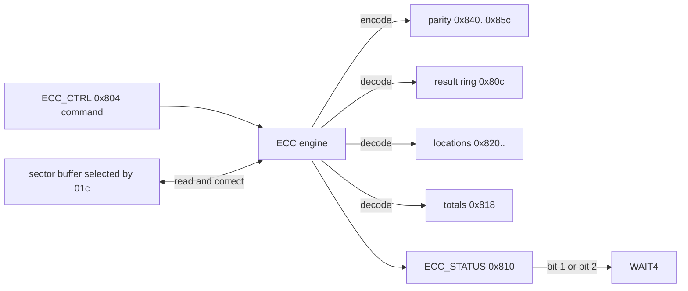

# Chapter 10 — ECC engine and codeword layout

Summary: the ECC engine at `0x800`. Its registers, the two BCH codes it computes
(BCH8 and BCH16 over GF(2^13)), the stream stored on the chip, encode, decode and
correction, the error-location words, the result ring and status bits, timing,
`WAIT4` and its acknowledgement, the data-path hazard and the interrupt state.

## 10.1 How error correction works

The engine works on one 512-byte data sector at a time, with BCH8 or BCH16
selected per operation. An encode computes the parity of a sector (data and,
for sector 0, metadata); a decode checks a sector against its stored parity,
corrects it in place when it can, and records a result, a count and the bit
locations of the corrections. Completion is signalled on `ECC_STATUS` (`0x810`),
which `wait 4` (`WAIT4`) follows.

The original programs use the 512-byte sector with BCH8 and BCH16 only, and no
`ECC_CTRL` word selects another code (M2-197).
Source anchors: `bl_NandReadOnly::_m2SetEccMode` at `mem:0x4fcc`, READ at
`mem:0x6438`, initialization at `mem:0x55d8`; restore WRITE at
`mem:0x080379e8`.

The engine does not depend on the sequencer: the same register writes issued
by the CPU, each `WAIT` replaced by a poll of its flag, decode the boot-ROM
format (three sectors of 26 parity and 512 data bytes, BCH16, `0x808` =
`0x80`) and the main BCH8 format with the same results as the original readers,
and CPU-kicked encodes give the host BCH8 parity (slots 0 and 1, with metadata
`0xa02`) and BCH16 parity (slot 0, with metadata `0xa06`) (M2-435, M2-436).

## 10.2 Registers

| Register | Meaning | Evidence |
|---|---|---|
| `0x01c` (FMC) | selects the ECC buffer/slot by bit 0, the only stored bit ([slots](#slots)) | source; M2-21, M2-417 |
| `0x800` | identification word, reads `0x20070618` | M2-116 |
| `0x804` | `ECC_CTRL`: command and mode ([section 10.3](#103-ecc_ctrl)); reads back without the command bits; storage mask `0x3f04` | M2-98, M2-101, M2-116, M2-191 |
| `0x808` | reads `0x700` (also at power-on); storage mask `0x1f81`; bits 12:8 = 0 make `0x810` bit 5 set after every completion (bit-5 threshold, inferred: [section 10.10](#1010-ecc_status-0x810)) | M2-116, M2-191, M2-430, M2-434 |
| `0x80c` | `ECC_RESULT`: 8-slot ring of decode results, advanced per read by the sequencer or the CPU, also through the copy at `0xa0c` ([section 10.9](#109-the-result-ring-0x80c)) | M2-90, M2-91 |
| `0x810` | `ECC_STATUS`: completion, uncorrectable, count-threshold and erased bits ([section 10.10](#1010-ecc_status-0x810)) | M2-88, M2-94, M2-95, M2-97, M2-99, M2-100 |
| `0x814` | storage mask `0x2f`; values 1, 2, 4, 8, `0x20`, `0x2f` read back and change neither a BCH8 decode (status, totals, data, time) nor BCH8 encode parity; `0x2f` changes neither BCH16 encode parity nor a BCH16 decode (`0x810`, `0x80c`, `0x818`, data) | M2-191, M2-660, M2-708, M2-709, M2-710 |
| `0x818` | (running total of corrected bits << 11) \| number of decodes ([section 10.11](#1011-corrected-totals-0x818)) | M2-89, M2-132 |
| `0x81c` | a write with bit 0 set = ECC reset: clears `0x818`, sets `0x810` to `0x10`, puts the ring's read and write positions at slot 0; values without bit 0 do nothing | M2-91, M2-96, M2-421 |
| `0x820..` | error locations of the last decode, 13-bit fields ([section 10.8](#108-error-locations-0x820)) | M2-128, M2-132, M2-138, M2-714 |
| `0x840..0x85c` | parity of the last encode ([section 10.6](#106-encode-and-the-parity-registers)); `0x844` holds no written bits | M2-116, M2-191 |
| `0x900..0x9fc` | read 0 after encodes and decodes; `0x940..0x950` drop writes | M2-171, M2-191 |

A per-case reset zeroes `ECC_CTRL` (M2-123); the step that does so is the ECC
reset `0x81c` = 1, which zeroes `ECC_CTRL` and no FMC word (M2-645). The storage masks are the same for
CPU and sequencer writes (M2-191). The M1 ECC area has no M2 counterpart:
`0x900..0x9fc` (`0x990` included) read 0 after BCH8 and BCH16 encodes of zero,
ones and ramp data and after decodes, and 0 or `0xffffffff` written to
`0x940..0x950` before an encode or decode changes neither the parity nor the
decode (data, `0x810`, `0x818`) (M2-72, M2-171). Offset bit 9 is not decoded
in `0x800..0xbff`: `0xa00..0xbfc` is a copy of `0x800..0x9fc` (M2-155). At
power-on `0x800` reads `0x20070618`, `0x808` `0x700`, `0x810` `0x10` and the
other ECC storage words 0, as after the reset (M2-430). M1's offsets (`ECC_KICK` `0x80c`, `ECC_RESULT` `0x810`,
`ECC_MODE` `0x814`, `ECC_DONE` `0x840`) name different registers on M2.

**Slots.** FMC `0x01c` stores bit 0 only (2, 4, 8, `0x100`, `0x80000000` read
0; 3, 7, `0xff` read 1), and an encode uses the data buffer of the slot that bit
selects: the parity at `0x840..` is that of the slot-0 data for even values and
of the slot-1 data for odd values; `WAIT4` passes in every case (M2-417). Two
encode kicks back to back (`0x01c` = 0, kick, `0x01c` = 1, kick, then `WAIT4`)
give one result, the slot-1 parity with `0x810` = `0x13`: the second kick
replaces the first (M2-418). Changing `0x01c` from 0 to 1 while a slot-0 BCH8
encode runs gives a parity that matches neither slot's data (M2-419).

## 10.3 `ECC_CTRL` (`0x804`)

| Bits | Effect (device) |
|---|---|
| 0 | decode |
| 1 | encode; with bit 0 also set the operation acts as a decode, and `0x003` / `0x007` encode nothing |
| 2 | BCH16 (clear = BCH8) |
| 7:3 | no effect on encode parity |
| 13:8 | metadata length in bytes: 0, 3, 10, 12 measured; 13, 16, 20 and 32 cover the 12 written metadata bytes followed by `0xff`; 33, 64, 128 and 255 give the parity of the data alone, as 0 |
| 15:14 | ignored; not stored |
| 23:16 | no effect on encode parity |
| 31:24 | no effect on encoding |

Evidence: M2-98, M2-101, M2-197, M2-662. Reading `0x804` returns the written word
without the command bits (M2-116); the stored bits are `0x3f04` (M2-191).

No `ECC_CTRL` word selects a code other than BCH8 and BCH16. Single bits 3..7
and 16..31, every pair of them and all of them together, with BCH8 and BCH16
and with metadata lengths `0x80` and `0xff`, give BCH8 or BCH16 parity as bit 2
selects, or none: 438 encodes classified, never the M1 RS-8/12/16 parity
(M2-197); with lengths `0x80` and `0xff` that parity covers the data alone
(M2-662).

The original driver writes `0xa01` / `0xa05` to decode the first sector with ten
metadata bytes and `0xa02` / `0xa06` to encode it (BCH8 / BCH16). Subsequent
sectors use `1` / `5` or `2` / `6`, without metadata. The original driver selects
BCH16 for eight-sector pages with a 218-byte spare and uses 26 parity bytes per
sector; BCH8 uses 13 (M2-22). These selection rules belong to that driver and
format, not to a hardware prohibition on other combinations.

M1's bit-15 Reed-Solomon selector falls in M2's ignored length bits 15:14 and
selects no code (M2-197).

## 10.4 Stream on the chip

For the 4 KiB page workload:

| Portion | BCH8 bytes | BCH16 bytes |
|---|---:|---:|
| First sector metadata | 10 | 10 |
| Parity per sector | 13 | 26 |
| Data per sector | 512 | 512 |
| Total parity, eight sectors | 104 | 208 |
| Metadata + parity | 114 | 218 |

The stream is metadata, parity, data for sector 0, then parity and data for each
remaining sector: `meta[10] | par[n] | data[512]`, then seven `par[n] | data[512]`
(n = 13 or 26). A 128-byte BCH8 spare leaves 14 spare-tail bytes after the 114
metadata/parity bytes. The CPU metadata output uses a 12-byte container; only
ten bytes are the page metadata. M1's three metadata bytes per sector and its
parity-buffer address and byte-order rules are not part of the M2 layout.

## 10.5 The codes

### 10.5.1 BCH8

BCH8 is M1's BCH8 code (M1 10.3.2; M2-77):

- field GF(2^13), x^13 + x^4 + x^3 + x + 1 (`0x201b`);
- generator `0x115f914e07b0c138741c5c4fb23`, degree 104, roots alpha^1..alpha^16;
- message = 512 data bytes then the covered metadata bytes, most significant bit first;
- parity = message × x^104 mod g, 13 bytes, most significant byte first.

Sector 0 covers all ten page metadata bytes (M1: three slot bytes per sector).
Sectors 1..7 cover only their data. Every non-erased raw sector examined (352 of
352, including pages written by the original firmware on CE0 and CE1) is a code
word of this code (M2-77).

### 10.5.2 BCH16

BCH16 is a narrow-sense binary BCH code with t = 16 over GF(2^13)/`0x201b`:
generator degree 208 (roots alpha^1..alpha^32); message = data then metadata,
most significant bit first; 26 parity bytes, most significant byte first. All 14
engine-encoded sectors match, and encoding is repeatable (M2-86). With
`0x814` = `0x2f` a BCH16 encode gives the same parity and `0x810` (`0x13`) as
with 0, and the parity equals the host BCH16 code (M2-708, M2-710).

## 10.6 Encode and the parity registers

An encode (`ECC_CTRL` bit 1) computes the parity of the selected sector. After
an encode, `0x840..0x85c` hold the parity,
equal to the parity written to NAND (M2-116):

| Code | Register order | Bytes |
|---|---|---:|
| BCH8 | low byte of `0x84c`, then `0x848`, `0x844`, `0x840`, each word big-endian | 13 |
| BCH16 | `0x858` (2 bytes), then down to `0x840` | 26 |

The word order is reversed and each word is big-endian. After an encode
`ECC_STATUS` reads `0x13` and `WAIT4` passes on bit 1 ([section 10.12](#1012-wait4-and-acknowledgement)).

Twenty programs with three encode commands each (BCH8/BCH16 × two slots × five
between-kick actions) all end; every recorded encode stage reads `0x80c` = 0 and
`0x810` = `0x13`, and reads of `0x900..0x910` are zero. Three commands
plus three passing waits there do not prove three independently completed
encodes (M2-72).

An encode kicked by CPU writes of `ECC_CTRL`, with no sequencer program
running, gives the same parity as the host BCH8 and BCH16 codes; pages
programmed with it, with software-encoded parity or from raw images read back
exactly through every reader ([chapter 12](12-cpu-interface.md); M2-712).

## 10.7 Decode and correction

A decode (`ECC_CTRL` bit 0) checks the sector against its parity and corrects
data, metadata and parity bits in place.

| Code | Corrected | Beyond the radius | Evidence |
|---|---|---|---|
| BCH8 | 1..8 bit errors in data, metadata, parity or mixtures (including bit 0, bit 4095, an 8-bit burst, 4 + 4 mixes), exactly | 9, 10 and 16 data errors and 5 data + 4 parity: data returned **unchanged** | M2-84 |
| BCH16 | up to 16 bit errors in data, metadata and parity | 17, 20, 24 and 9 + 8 parity errors: data returned unchanged | M2-92 |

No miscorrection occurs beyond the radius: 13,440 random BCH8 sectors with 9..64
errors and 11,520 random BCH16 sectors with 17..64 errors are all uncorrectable,
with the data unchanged (M2-174).
All-zero and all-`0xff` data with valid parity, and clean sectors, read exact. The
raw pages carrying host-built code words with known errors were verified by raw
read-back before decoding, and were read through the original READ sequence.

A decode of a sector without valid parity reports uncorrectable: 2,080 such
decodes all returned `0x80c` = 1. They had no valid parity written for the input,
so they test neither the correction radius nor miscorrection (M2-73).

An all-zero sector-0 chunk (metadata, parity and data 0) decodes as a clean code
word with BCH8 and BCH16 (`0x810` bit 3 clear, `0x80c` = 0): zero parity is the
valid parity of zero data and is not treated specially; `0xff` data with zero
parity is uncorrectable (M2-214).

An erased sector sets `ECC_STATUS` bit 6 (`0x55`), and its ring entry is 0
(M2-95). The NAND controller's `FMC_STATUS` bit 27 also separates the two: it
is set after the transfer of a programmed sector and clear after an erased one
([chapter 9, section 9.7](09-nand-controller.md#97-fmc_status-flags); M2-145).

A BCH16 decode of a host code word with 12 data errors gives `0x810` `0x35`,
`0x80c` 0, `0x818` `0x6001` (12 corrections, one sector) and the clean data,
the same with `0x814` = `0x2f` as with 0 (M2-709, M2-710).

A decode kicked by the CPU alone corrects as the software BCH decoder does:
with 1, 2, 4, 7 and 8 injected data errors, 3 errors in metadata or parity and
one 9-error sector per page, both return the same data, metadata, correction
counts and location sets, and both leave the 9-error sector uncorrectable and
as stored (M2-711, M2-713).

## 10.8 Error locations (`0x820..`)

After a decode, `0x820..` hold the corrected bit locations as consecutive 13-bit
fields from bit 0 of `0x820`, in ascending byte order, and within one byte the
higher bit first: a sector with errors at bits 2 and 3 of byte 512 reports
4099 before 4098 (M2-128, M2-714). Bits above the last
location read 0. BCH8 uses up to 8 fields; BCH16 up to 16 (`0x820..0x839`). The
`0x818` total field gives the number of corrections; in the location captures
`0x818` bits 15:11 gave the count.

The location space is the message in order, data, metadata, parity, each byte
numbered least significant bit first (M2-132, M2-138):

| Part | Location |
|---|---|
| data byte b, bit i (i = 0 is the LSB) | b × 8 + i, 0..4095 |
| sector-0 metadata byte b, bit i | 4096 + b × 8 + i, 4096..4175 |
| sector-0 parity byte b, bit i | 4176 + b × 8 + i |
| parity byte b, bit i, sectors without metadata | 4096 + b × 8 + i |

Metadata and parity corrections appear as fields. Uncorrectable and clean sectors
leave every field 0. All 36 locations of 1..8-error sectors, 15 of 15 numbering
cases and 4 of 4 sector-0 parity cases matched (M2-128, M2-132, M2-138); the
location sets of CPU-kicked decodes equal those of the software decoder
(M2-713).

## 10.9 The result ring (`0x80c`)

`0x80c` holds the last eight decode results:

| Entry | Meaning |
|---|---|
| `n << 16` | n bits corrected (the original driver extracts bits 20:16) |
| `0` | no error, or an erased sector |
| `1` | uncorrectable (bit 0; the original driver tests it) |

Each read returns the slot under a read pointer and advances it: read i returns
slot[i mod 8]. Reads of `0x810` / `0x818` and writes of `0x80c` do not move the
pointer. ECC reset (`0x81c` = 1) puts the read and write positions at slot 0,
after which one read per decode returns that decode's result. The original CPU
driver writes `0x81c` = 1 in `_resetFMSS`, and its READ reads `0x80c` exactly
once per decode (M2-90, M2-91). Reads by the sequencer and by the CPU
advance the pointer alike, also through the copy at `0xa0c`; `0x90c` and
`0xb0c` read 0 and do not move it (M2-91).

Extra reads shift later results. In READ-sequence captures with additional
result reads, the read after `WAIT4` and acknowledge did not report the current
sector: it reads 0 for
corrected and for most uncorrectable sectors, bit 0 is never set, and the few
non-zero values appear only in the last sector of a page (M2-85). The ring
behaviour accounts for this (M2-90); M2-85 records retained completion as the
earlier inferred cause.

## 10.10 `ECC_STATUS` (`0x810`)

| Bit | Meaning (device) | Evidence |
|---|---|---|
| 0 | done; writing 1 clears it, without re-arming `WAIT4` | M2-67, M2-97 |
| 1 | encode complete; the `WAIT4` level after an encode; write 1 to clear | M2-97 |
| 2 | decode complete; the `WAIT4` level after a decode; write 1 to clear | M2-99 |
| 3 | uncorrectable | M2-88 |
| 4 | reads 1 when idle, after ECC reset, after an encode and after acknowledge `0x1ff`; writing 1 changes nothing; meaning not established | M2-88, M2-96, M2-420 |
| 5 | at least 7 corrected bits (BCH8: 6 → clear, 7 → set; the same threshold for BCH16); set after every encode and clean decode when `0x808` bits 12:8 are 0 | M2-94, M2-100, M2-434 |
| 6 | erased sector; write 1 to clear | M2-95, M2-99 |

Bits 7..12, 16, 24 and 31 are never set, neither by writing 1 to them nor by
a BCH8 encode (M2-420). The count from which bit 5 is set equals `0x808` bits
12:8, which reset to 7: with them 0 bit 5 is set after every BCH8 encode and
clean decode (`0x33` / `0x35`), with one of bits 8..12 set it stays clear (role
inferred, M2-434). Bits 3 and 5 accumulate across decodes unless `0x1ff` is
written. The source
writes 1 after `WAIT4` and `0x1ff` for broad clearing.

| Value | State |
|---|---|
| `0x10` | idle, at power-on and after ECC reset (`0x81c` with bit 0 set) |
| `0x13` | encode complete |
| `0x12` | encode complete, after acknowledge 1 |
| `0x15` | decode complete, 0..6 corrected bits |
| `0x14` | decode complete, after acknowledge 1 |
| `0x35` | decode complete, 7 or more corrected bits |
| `0x1d` | decode complete, uncorrectable |
| `0x55` | decode of an erased sector |

## 10.11 Corrected totals (`0x818`)

`0x818` = (running total of corrected bits << 11) | number of decodes. The total
(bits 31:11) counts every corrected bit, including metadata and parity bits, and
skips uncorrectable sectors. ECC reset (`0x81c` = 1) clears it (M2-89, M2-96,
M2-132).

## 10.12 `WAIT4` and acknowledgement

`wait 4` follows `ECC_STATUS` bit 1 after an encode and bit 2 after a decode
(M2-97, M2-99). Writing 1 clears only bit 0, so `WAIT4` still passes after an
acknowledge of 1: a repeated `WAIT4` after `0x810` = 1 passes, and the encode
completion `0x13` becomes `0x12` (M2-67). Bits 1 and 2 are write-1-to-clear. In
`C50`, bit 4 is the ECC flag and bits 11..12 indicate ECC idle (M2-112).

A write of `0x81c` with bit 0 set after a completed encode changes `0x810`
from `0x13` to `0x10`, and a following `WAIT4` faults; values without bit 0
(0, 2, 4, `0x80`, `0x100`) change nothing and `WAIT4` still passes (M2-421).

The original-program `WAIT4` control after an encode reaches END with
`ECC_STATUS` = `0x13`, bit 2 clear; that is the encode level (bit 1).

## 10.13 Timing

| Operation | Time after the kick (device) | Evidence |
|---|---|---|
| encode, BCH8 or BCH16 | ≈ 4.1 us | M2-118 |
| decode, zero syndromes | ≈ 4.0 us | M2-133 |
| decode, erased sector | ≈ 4.1 us | M2-118 |
| decode, any non-zero syndrome, BCH8 | ≈ 4.0 + 1.6 us: ≈ 5.8–6.0 us for 1..8 errors, ≈ 5.8 us uncorrectable | M2-118, M2-129, M2-133 |
| decode, any non-zero syndrome, BCH16 | ≈ 4.0 + 2.3 us | M2-133 |

The extra time is independent of the error count and of whether the decode
succeeds.

## 10.14 Data-path hazard

Serial and different-slot DMA/ECC overlap is byte exact for BCH8 and BCH16
(M2-80). A DMA on a buffer under its own encode (0, 8 or 32 `nop2` after the
kick) is not interlocked and sets `FMC_STATUS` bit 25 (`0x048` = `0x020c3000`
against `0x000c3000`):

- into the buffer: 68..164 old bytes stay in 4..32-byte runs, and the parity
  matches neither the old nor the new data at gaps 0 and 8, the old data at gap
  32 (M2-80, M2-399);
- out of the buffer: runs of 12..32 bytes about every 96 bytes of the output
  differ (344..424 of 512 bytes delivered), while the parity is that of the
  buffer data and the buffer is unchanged (M2-401).

After 128 `nop2`, or with the DMA after `WAIT4`, the transfer is exact and bit
25 stays clear; bit 25 appears only in these same-buffer cases (M2-71, M2-80,
M2-399, M2-401; the meaning of the flag is inferred). Serial DMA itself is
exact ([chapter 9, section 9.5](09-nand-controller.md#95-dma)).

## 10.15 Interrupt

No ECC interrupt is found on M2. After BCH8 encodes and decodes, with `0x044` =
0 or all ones and `0x800`, `0x808`, `0x814`, `0x818`, `0x844` and
`0x860..0x9fc` written all ones, single bits of `0x808`, `0x814`, `0x818` and
`0x844`, `ECC_CTRL` bits 3..7 and 16..31 or `0x810` bits 9..31 written,
`CS_IRQ` bits 5 and 6 stay clear while `0x810` shows every completion, no VIC
raw line rises beyond the no-candidate baseline and `wait2 20` and `wait2 43`
never pass, while `wait 4` passes (M2-212). VIC1 line 11 (M1 ECC source 43) and every
other VIC line stay at the baseline after BCH8 encode and decode completions for
every tested ECC word (`0x800`, `0x808`, `0x814`, `0x860..0x9fc`; values
`0xffffffff`, 1, `0xffff`, `0xffff0000`, `0x55555555`, `0xaaaaaaaa`; `0x044` = 0
or all ones; 751 cases) (M2-217). The NAND controller sources raise VIC0 line 20
(M2-142, M2-200). M1's `0x844` enable has no M2 counterpart: `0x844` is an
encode-parity word ([section 10.6](#106-encode-and-the-parity-registers)).

## 10.16 Limits of the evidence and the model

Early zero ECC register snapshots and late register/ECC records that never
executed are not measurements and not successful decodes (M2-23).

The M2 simulator runs original programs and the actual ARM physical driver
against both layouts. Its BCH8 parity is the physical code of
[section 10.5.1](#physical-bch8-code); BCH16 parity is a hash stand-in. It checks
data movement, metadata placement, mode selection, erased handling and error
propagation. It does not model correction counts, miscorrection rates or
Reed–Solomon. It distinguishes encode and decode readback and keeps the measured
completion level after acknowledge 1; its internal done bit is not a physical
register-bit claim. These limits are stated in [the simulator contract](14-evidence.md).

Open: the meaning of `ECC_STATUS` bit 4, its untested bits 13..15, 17..23 and
25..30, the bits of `0x80c` outside the result fields, the role of `0x814` (stored, with no effect on BCH8 or BCH16 encode and decode, M2-660, M2-710) and
of `0x808` beyond the inferred bit-5 threshold, and an ECC interrupt source
outside the tested words ([chapter 17](17-open-questions.md), items 13 and
23).

References: [ledger](18-ledger.md), [evidence](14-evidence.md),
[device findings](16-device-findings.md).
