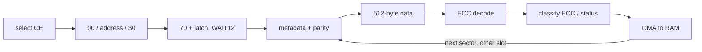

# Chapter 11 — Original M2 programs and operation sequences

Summary: The original sequencer programs (RESET, READID, READ, ERASE, WRITE and
the boot-page programs), how READ walks a page, how a run ends, and the
completion and acknowledgement rules that every NAND transaction on M2 follows.
The controller registers are in [chapter 9](09-nand-controller.md#nand-controller-buffers-and-dma),
the ECC engine in [chapter 10](10-ecc-engine.md#ecc-engine-and-codeword-layout),
the parameter words in [chapter 12](12-cpu-interface.md#cpu-interface-and-software-abi).

## 11.1 The original programs

The original firmware supplies sequencer programs; it does not implement the
whole NAND transaction by ARM MMIO polling. The CPU supplies a
program-specific parameter ABI, starts FMSS, handles completion, pause and
fault, and interprets r6 and the DMA output. The logical VFL/FTL layers sit
above this physical interface.

| Program | Source anchor | Operation |
|---|---|---|
| RESET | `bl_NandReadOnly mem:0x76c0` | select CEs, send `ff`, wait command complete, deselect; the CPU adds a delay |
| READID | `bl_NandReadOnly mem:0x7550`; restore `mem:0x080377a0` | send `90`, column 0, read five bytes, latch the first four into an ID word per CE |
| READ | `bl_NandReadOnly mem:0x6438`; restore `mem:0x08036688` | multi-CE issue/ready/transfer pipeline, sector ECC, metadata and DMA |
| ERASE | restore `mem:0x08036398` | address the target, confirm erase, poll status and report failure |
| WRITE | restore `mem:0x080379e8` | DMA data into slots, encode metadata/parity, transfer the page, program confirm/status |
| BLREAD / BLWRITE | restore OS boot-page programs | ROM-format boot-page programs with a distinct parameter/layout contract |

The cross-version survey contains 73 program instances and eight distinct
programs. Two WRITE generations have different result conventions, so an r6
field cannot be generalized across them. Apple's original ERASE and
WRITE programs, unmodified, with their parameter blocks erase and program a
block and the page reads back exactly, data and metadata (M2-726).

WRITE reads its DMA list pages × chunks + 1 times: one prefetch before the
transfer loop (WRITE program offset 0x050) and one read per chunk (0x3f0) before the
chunk-count test, so the last entry read lies beyond the list and is not used
for a transfer (source, M2-213).

## 11.2 Reading a page (program READ)

READ selects a CE, issues `00`/address/`30`, then polls NAND status with `70`
and `WAIT12`. It transfers first-sector metadata/parity, then data, runs ECC,
classifies the ECC and status results, and DMAs corrected data to system RAM.
It repeats for the remaining sectors with alternating slots (M2-21). Separate
counters and CE masks track issued, waiting and transferring pages. Parameters
such as row pointers, CE pointers and DMA-list pointers advance during
execution.

## 11.3 End and fault results

END means the microcode finished; the page and sector results still carry the
outcome. Fault handlers read `c3c`, capture the selected CE state, deselect the
chips, set a program-defined error result, acknowledge `c50` and END. An IRQ
fault followed by END and a successful END are different results.

Reaching END in a program or erase path does not by itself certify page
contents, codeword validity or every driver transfer. In particular, a program
that leaves a DMA completion unacknowledged reaches END with its DMA output cut
([section 11.4](#114-completion-and-acknowledgement-rules)).

## 11.4 Completion and acknowledgement rules

Measured M2 rules that a NAND transaction follows (flags and waits in
[chapter 7](07-events-and-waits.md#events-waits-and-timeout-interpretation)
and [chapter 9](09-nand-controller.md#97-fmc_status-flags)):

| Step | Rule | Evidence |
|---|---|---|
| command, address, DMA | `WAIT0`/`WAIT1`/`WAIT2` do not consume `FMC_STATUS` bits 1/2/20; a repeated or triple wait passes; acknowledging makes the next wait block; a new operation re-arms it | M2-66 |
| ECC | `WAIT4` follows `0x810` bit 1 after an encode and bit 2 after a decode (write-1-to-clear); writing 1 to `0x810` clears only bit 0, and `WAIT4` still passes | M2-67, M2-97, M2-99 |
| status | one `70h` + `0xca` latch polls until the chip is ready; `WAIT5` passes for the standard latch (`70h`, `wait 0`, acknowledge, latch) every time, and for every tested ordering in which the `70h` was waited for and acknowledged; a latch one or two instructions after an unwaited `70h` (one or two `nop2`, one `nop`, one `movi` or the bit-1 acknowledge between) sets `FMC_STATUS` bit 3 instead of bit 23 and its `WAIT5` faults, while a latch straight after it or three or more instructions later passes; `WAIT12` passes iff status & arg & mask ≠ 0 and releases only when the chip is ready; masked `WAIT12` passes after `FMC_STATUS` bit 23 is cleared; the latch works with `FMC_DATA_SEL` `0x100`, `0x200` and 1 | M2-68, M2-130, M2-134, M2-137, M2-161, M2-169, M2-178, M2-196, M2-593 |
| ready/busy | no `WAIT` 0..15 (arg = mask = 0) and no `wait2` N follows the NAND ready/busy line | M2-107, M2-167 |
| next command after status | an active status latch survives END and blocks the next command's `WAIT0` until an `FMCTRL1` write (`FMCTRL1` = `0x20` / `0x10020` / `0x30020` in the originals); status clear, ECC kick and `FFh` do not release it | M2-31, M2-32, M2-181, M2-202 |
| second latch | a second `0xca` latch without a new `70h` needs no re-arm: after the first latch's `WAIT5` and only the bit-23 acknowledge it passes `WAIT5`; an address operation in that position does not complete (its `wait 1` times out, `FMC_STATUS` bit 26 sets) | M2-494, M2-610 |
| polls of two chips | with the release (`0x30020` + acknowledge) between polls, polls of CE0 and CE1 during an erase pass in both orders; without it the second chip's `70h` is refused | M2-198 |
| DMA length | a DMA moves 512 bytes whatever `FMC_DNUM` holds | M2-189 |
| one DMA at a time | a DMA programmed while the previous one runs rewrites the running transfer's address and buffer select, which it follows from that point on; no second transfer starts and the second `wait 2` never passes | M2-78, M2-114, M2-394, M2-603 |
| one operation at a time | an `FMCTRL1` operation written before the previous one completes suppresses the previous completion flag, though its data move | M2-332 |
| DMA enable | a DMA programmed with `FMC_CTRL0` bit 24 clear is held until the bit is set | M2-338 |
| DMA and ECC | a DMA into or out of a buffer whose own ECC encode is running is not interlocked and corrupts 4..32-byte runs; serial and different-slot overlap is exact | M2-80, M2-399, M2-401 |

The ECC acknowledgement and masked `WAIT12` therefore behave differently from a
common one-shot flag.

## 11.5 Reset, READ ID, program and erase as stimuli

READID is an independent peripheral baseline: it returned Hynix IDs on four
CEs, and the FIFO READ ID returns `AD D5 14 B6 44` (M2-124). NAND reset,
status, address, DMA and ECC actions create controlled event sources for
sequencer experiments; chip latency does not measure instruction latency.

Serial program and erase sequences run on the device: programs on CE0 and CE1
(single raw and ECC pages, four and eight pages per run, one page on each CE in
one run) and erases on CE0 and CE1 read back exactly, erased pages all `0xff`
and status `0xe0` after each (M2-194); multi-page program runs poll status on
`FMC_DATA_SEL` `0x200`, `0x100` or 1 (M2-196); a four-cycle erase
(`FMC_ANUM` = 3) erases the block like the three-cycle one (M2-168). A
two-plane program (`80h`, row, data, `11h`, ready, `81h`, row of the second
block, data, `10h`, ready) of page 0 of blocks 3000 and 3001 reads back exactly
on both blocks, and a two-plane erase (`60h`, row, `60h`, row, `D0h`, ready)
leaves both pages all `0xff`, with status `0xe0` after each (M2-339).

The same register sequences run from the CPU alone, with no sequencer program
and each `WAIT` replaced by a bounded poll of its flag: raw page reads by DMA
and by `FMC_FIFO` return the bytes of the sequencer raw read, CPU-kicked
decodes of the boot-ROM (BCH16) and main (BCH8) formats equal the original
readers' output, and a CPU erase and a CPU program with host BCH8 parity read
back exactly, also through the sequencer READ (M2-435, M2-436). Programs from
engine-encoded, software-encoded and raw images in both formats read back
exactly through every reader, and engine and software decoders agree on
injected errors ([chapter 12, section 12.7](12-cpu-interface.md#127-controller-access-by-the-cpu-alone);
M2-711..M2-716).

The experiment set contains serial M2 page read/write/erase sequences and
selected overlap comparisons. It does not reproduce every original multi-CE
pipeline or boot-page workload. Assembling the programs is not
physical validation of those operations; the gaps are listed in
[chapter 13](13-experiments.md#m2-experiment-coverage).

## 11.6 nano4g and nano5g

The nano4g and nano5g can share FMSS program logic and reset/start helpers
while retaining different CPU-side clocks, pins, power, IRQ integration and
parameter contracts. Shared program bytes alone do not transfer physical
register or timing findings from one SoC to the other.
